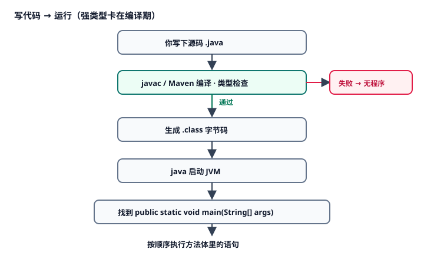
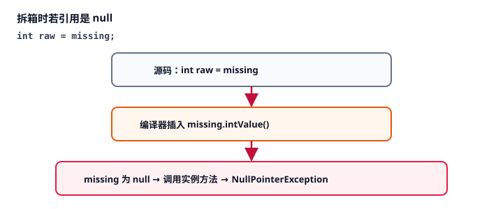
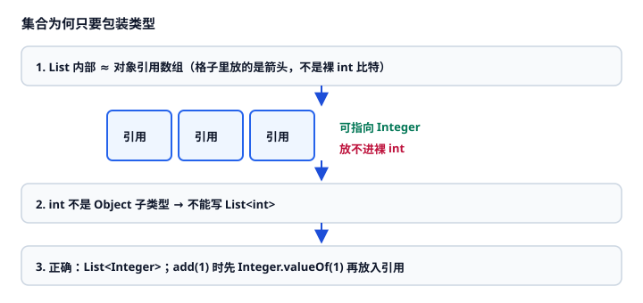
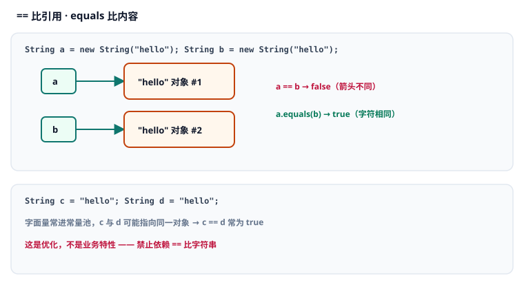
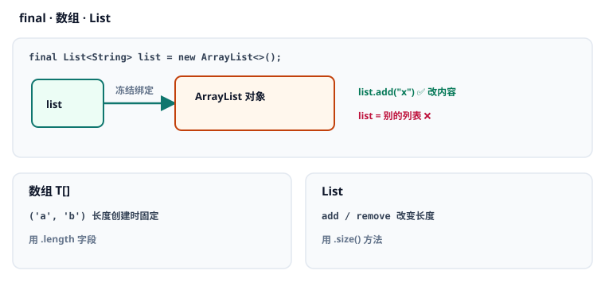
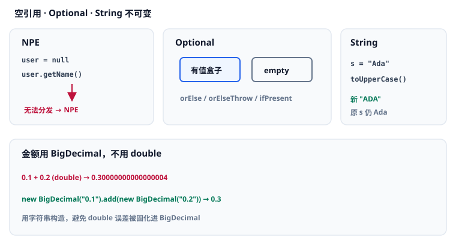

# 1. 强类型与基础语法

本章讨论 Java 如何用 <Term id="strong-typing" strong /> 约束程序，以及你每天都会用到的基础语句：变量、<Term id="primitive" /> 与 <Term id="wrapper" />、转换与分支循环、相等比较、<Term id="final" />、数组与列表、方法与 <Term id="value-passing" />，以及空值与字符串。

本章不是词条词典。七个知识要点按因果排列：先解决「为什么要类型、程序从哪开始」，再解决「值怎么存放」，然后才能「把语句串起来」「判断相等」「约束引用与组织代码」，再弄清「方法传参到底传什么」，最后处理「空」和文本。带点状下划线的词可点开释义，汇总见 [术语表](./glossary.md)。

还没装好 JDK 17？先回 [00 · 安装 JDK 与工具链](./00-install-jdk-and-toolchain.md)。  
对应代码：[`StrongTypingDemo.java`](./src/main/java/com/jffd/core/typing/StrongTypingDemo.java)

深度与考点对齐吸收自 [JavaGuide · 值传递](https://javaguide.cn/java/basis/why-there-only-value-passing-in-java.html)、[BigDecimal](https://javaguide.cn/java/basis/bigdecimal.html) 等篇，已按本仓库 MDN 六段式重写（Apache-2.0）。

| | |
|--|--|
| 前置 | 第 0 章已通过；会写 TypeScript 的变量、函数、`if`/`for`。 |
| 学完应能 | 解释强类型解决什么问题；读懂 `main` 与变量声明；区分 `int`/`Integer` 并说明为何不能 `List<int>`；会做类型转换与 `if`/`for`；正确使用 `==`/`equals`、`final`；说明 Java 只有值传递；处理空引用与金额精度。 |

---

## 知识要点一：强类型、最小程序与变量声明

上一章你已经能让 JVM 跑起来。接下来要回答的是：Java 凭什么在你「还没点运行」时就拦住一批错误？以及，一段合法的 Java 代码最小长什么样？

### 1. 概述 (Overview)

如果你在宽松的 JavaScript 里写错类型，常常要等到运行、甚至等到某个分支被点到才爆炸。前端用 TypeScript，本质就是把一部分错误提前到编译期。

Java 的强类型**（更准确说：静态强类型）做的是同一类事，而且更彻底：每个变量、参数、返回值在编译期都有确定类型；对不上就会**编译失败**，字节码都不会生成。没有它，后端这种「接口一多、调用链一长」的代码会把类型错误拖到联调甚至生产才发现。

核心定位：

- **强类型**：用编译器当第一道质检。  
- **最小程序**：所有逻辑都住在类里，从 `main` 启动。  
- **变量声明**：先说类型（或让编译器从右边推断），再存值。

### 2. 底层心智模型 (Mental Model)

把一次「写代码 → 运行」想成流水线：类型对不上会在**编译期**被拦住，根本不会生成可运行程序。



变量在方法里时，可以先这样理解（细节到第 2 章、模块二再加深）：调用 `main` 后，当前方法的**栈帧**里会开辟局部变量槽位——`int count = 42` 是槽位里直接放整数；`String name = "Ada"` 是槽位里放「指向堆上 String 对象的引用」。两种存放方式的对照图见下一知识要点。

因果链是：

1. 没有通过编译，就没有可执行程序 → 类型错误被消灭在上线前。  
2. JVM 只从约定好的 `main` 入口往下走 → 你必须认识这层壳子。  
3. 局部变量占用栈帧槽位 → 「先声明类型、再赋值再用」才有意义。

### 3. 语法与核心 API 签名 (Syntax & Parameters)

#### 最小类与入口

```java
[public] class ClassName {
    public static void main(String[] args) {
        // 语句…
    }
}
```

| 片段 | 在这里的作用 |
|------|----------------|
| `public`（类前） | 该类可被其他包访问；入口类通常公开。 |
| `class ClassName` | 定义名为 `ClassName` 的类；源文件里的 `public` 类名须与文件名一致。 |
| `public`（方法前） | JVM 在类外调用 `main`，必须公开。 |
| `static` | 方法属于类本身，不必先 `new` 对象；JVM 直接按类名调用。 |
| `void` | 不返回值。 |
| `main` | 入口方法名，固定写法。 |
| `String[] args` | 命令行参数数组；暂时用不到也要写上。 |

#### 变量声明

```java
TypeName variableName = initialValue;
TypeName variableName;   // 局部变量：使用前必须再赋值
var variableName = initialValue; // 仅局部变量；由右边推断类型（Java 10+）
```

| 片段 | 含义 |
|------|------|
| `TypeName` | 编译期类型，例如 `int`、`String`。 |
| `variableName` | 标识符；习惯 `camelCase`。 |
| `=` | 赋值；右边表达式的类型必须能赋给左边。 |
| `;` | 结束一条语句（Java 一般不能像 JS 那样随意省略）。 |

### 4. 渐进式示例 (Examples)

#### 示例 1：最小可运行原型

```java
public class Hello {
    public static void main(String[] args) {
        int count = 42;
        String title = "order";
        System.out.println(title + "=" + count);
    }
}
```

```text
// 控制台输出：
order=42
```

逐行执行逻辑：

1. JVM 加载 `Hello`，调用 `main`。  
2. 在栈帧创建 `int` 槽位 `count`，写入 `42`。  
3. 创建 `String` 引用 `title`，指向字面量 `"order"` 对应的字符串对象。  
4. `println` 把拼接结果写到标准输出。

#### 示例 2：贴近业务的「读入配置并打印」

假设你在本地启动一个小工具，用变量接收「端口」和「应用名」（真实项目里它们常来自配置或环境变量，这里先写死，只练声明）：

```java
public class BootBanner {
    public static void main(String[] args) {
        final int serverPort = 8080;
        String appName = "billing-api";
        boolean ready = true;

        if (ready) {
            System.out.println("start " + appName + " on " + serverPort);
        }
    }
}
```

```text
// 控制台输出：
start billing-api on 8080
```

逐行执行逻辑：

1. `serverPort` 声明为 `int`，并用 `final` 表示启动后不改端口名绑定（`final` 细节见知识要点五）。  
2. `appName`、`ready` 按类型放入栈帧。  
3. `if (ready)` 要求条件为 `boolean`；为 `true` 时进入分支并打印。  
4. 若把 `ready` 改成字符串或数字，编译器会直接拒绝——这就是强类型在分支上的体现。

### 5. 常见错误与避坑指南 (Common Pitfalls)

#### 错误写法：类型与值不匹配

```java example-bad
int count = 42;
count = "forty-two"; // 编译错误
```

#### 正确写法

```java example-good
int count = 42;
count = 43;
// 若需要文本，另声明：String label = "forty-two";
```

根因：左边已是 `int`，右边是 `String`，赋值兼容性检查失败。

---

#### 错误写法：局部变量未初始化就使用

```java example-bad
int total;
System.out.println(total); // 编译错误
```

#### 正确写法

```java example-good
int total = 0;
System.out.println(total);
```

根因：局部变量没有默认值；编译器要求「使用前必赋值」，避免读到垃圾值。

---

#### 错误写法：入口方法签名写错

```java example-bad
public void main(String[] args) { } // 缺 static，JVM 找不到入口
```

#### 正确写法

```java example-good
public static void main(String[] args) { }
```

根因：启动协议约定的是 `public static void main(String[])`；差一个修饰符就不是入口。

### 6. 前端 vs Java 快速对照表 (Comparison)

| 维度 | TypeScript / JavaScript | Java |
|------|-------------------------|------|
| 类型检查时机 | TS：编译期；JS：几乎不查 | 编译期强制 |
| 跑起来后类型 | TS 擦成 JS，运行时不管 | 仍有大量运行时类型信息 |
| 程序入口 | 文件顶层 / bundler 入口 | `main` 方法 |
| 声明变量 | `let x: number = 1` | `int x = 1;` |
| 语句分号 | 常可 ASI 省略 | 几乎总需要 `;` |
| 真值条件 | `if (1)`、`if (obj)` 常见 | 条件必须是 `boolean` |

---

有了「能编译的程序」和「带类型的变量」之后，下一个问题自然出现：这些类型里，哪些是「纯数字开关」，哪些是「对象」？为什么后端接口字段一会儿写成 `long`，一会儿写成 `Long`？

## 知识要点二：基本类型、引用类型、包装类型与装箱拆箱

上一节解决了「程序从哪开始、变量怎么声明」。接下来要回答：声明时写的那个类型名，到底分哪几族？同是「数字」，`int` 和 `Integer` 差在哪？

本节只立三族类型，并**一个类型一个类型**讲完。先别急着背对照表——表在本节末尾。

### 1. 概述 (Overview)

在 TypeScript 里，日常几乎只有：`number` / `boolean` / `string` / 对象。一个 `number` 既可本地算账，也可在接口里写成 `number | null` 表示「可能没传」。

Java 不允许这样糊成一锅。它把值分成三族：

1. <Term id="primitive" strong />（primitive）：8 种纯值，槽位里直接是比特，**不能为 null**，也没有方法。  
2. <Term id="reference-type" strong />（reference）：变量里只存**箭头（引用）**，指向堆上的对象；箭头可以是 `null`。`String`、数组、你自己写的类、`List` 都属于这一族。  
3. <Term id="wrapper" strong />（wrapper）：JDK 为每种基本类型配的**类**（如 `Integer`）。它本身是引用类型，但专门用来「把一个基本类型的值包成对象」。

没有这套区分会怎样？

- 集合（`List` / `Map`）格子里只能放对象引用 → 裸 `int` 塞不进去。  
- 数据库 / JSON 里「这个字段没值」需要 `null` → 基本类型表达不了，只能发明 `-1` 这种魔法数。

核心定位：本地计数、循环、算数用基本类型；文本、对象、集合用引用类型；「可空的数字 / 布尔」以及放进 `List` 时用包装类型。两族数字之间靠 <Term id="boxing" strong /> / <Term id="unboxing" strong /> 自动转换。

### 2. 底层心智模型 (Mental Model)

三族在内存里的样子不一样：


读图顺序：

1. `int count = 42`：槽位里就是 `42` 本身。  
2. `Integer boxed = 42`：槽位里是箭头，指向堆上的 `Integer` 对象，对象内部再存 `42`。  
3. `Integer missing = null`：槽位里是「没有箭头」。

对 `null` 拆箱会发生什么：



为什么集合只能写 `List<Integer>`：



（泛型在运行时还会擦除成引用类型，类型参数不能是基本类型。深水区见 [4.4 类型擦除](./04-generics.md#44-类型擦除)。）

### 3. 语法与核心 API 签名 (Syntax & Parameters)

下面按「一族一类」写。每一类先给一句人话，再给最短可编译片段。

---

#### 族 A：基本类型（8 个，值直接在槽位）

通用形态：

```java
类型名 变量名 = 字面量;
```

##### 1）`int` —— 默认整数

范围大约 ±21 亿。循环计数、数量、普通整数优先用它。字面量直接写数字。

```java
int age = 18;
int total = age + 1;
System.out.println(total); // 19
```

##### 2）`long` —— 更大的整数

比 `int` 更大，常用于数据库自增 ID、时间戳。字面量末尾要加 **`L`**，否则编译器先当 `int` 看。

```java
long userId = 10001L;
long millis = System.currentTimeMillis();
System.out.println(userId);
```

##### 3）`double` —— 默认小数

二进制浮点，适合科学计算、一般小数。**金额、费率不要用它**（后面用 `BigDecimal`）。

```java
double ratio = 0.1;
System.out.println(ratio + 0.2); // 不是精确的 0.3
```

##### 4）`boolean` —— 真 / 假

只有 `true` / `false`。`if` 条件必须是 `boolean`，不能像 JS 那样写 `if (1)`。

```java
boolean ready = true;
if (ready) {
    System.out.println("go");
}
```

##### 5）`byte` —— 很小的整数（-128～127）

占 1 字节，多见于二进制协议、图片像素缓冲。日常业务很少手写。

```java
byte flag = 1;
System.out.println(flag); // 1
```

##### 6）`short` —— 较短整数（约 ±3 万）

占 2 字节，现在业务代码里也很少单独用，了解即可。

```java
short portHint = 8080;
System.out.println(portHint);
```

##### 7）`float` —— 单精度小数

比 `double` 省空间、精度更差。字面量要加 **`f`**，否则 `0.1` 默认是 `double`。

```java
float score = 98.5f;
System.out.println(score);
```

##### 8）`char` —— 单个字符

用单引号 `'A'`。日常文本用 `String`，不要用 `char` 拼长句子。

```java
char grade = 'A';
System.out.println(grade); // A
```

这 8 个共同点：**不能赋 `null`**，没有 `.equals()` 这类实例方法，`==` 比的就是数值本身。

---

#### 族 B：引用类型（变量里是箭头）

通用形态：

```java
类型名 变量名 = 表达式;   // 表达式算出一个对象，变量保存指向它的引用
类型名 空的 = null;        // 合法：没有指向任何对象
```

##### 9）`String` —— 文本（最常用的引用类型）

`String` **不是**基本类型。它是类，变量里存的是引用。内容用双引号。

```java
String name = "Ada";
String empty = null;          // 可以表示「没有名字」
System.out.println(name.length()); // 3 —— 通过引用调用对象上的方法
```

##### 10）数组 —— 固定长度的一串同类型格子

`int[]` 是「装着 int 的数组对象」，变量本身仍是引用；但格子里若是基本类型，格子内存的是值。

```java
int[] scores = {90, 80, 70};
scores[0] = 95;
System.out.println(scores.length); // 3
```

##### 11）你自己写的类 / 集合 —— 也是引用类型

```java
List<String> tags = new ArrayList<>();
tags.add("java");
System.out.println(tags.get(0)); // java
```

`List`、`Map`、以及 `new User(...)` 出来的对象，变量里都是箭头。细节在后面集合章与 OOP 章展开；这里只要记住：凡是对象，变量存的都是引用。

---

#### 族 C：包装类型（把基本类型包成对象）

每种基本类型都有一个对应的类。类名多数是首字母大写；两个例外：`int → Integer`，`char → Character`。

| 基本类型 | 包装类型 |
|----------|----------|
| `byte` | `Byte` |
| `short` | `Short` |
| `int` | `Integer` |
| `long` | `Long` |
| `float` | `Float` |
| `double` | `Double` |
| `boolean` | `Boolean` |
| `char` | `Character` |

包装类型的价值就两件事：可以为 null，以及能放进 `List` / `Map` / 泛型。

##### 12）`Integer` —— `int` 的对象版

```java
Integer count = 42;       // 自动装箱，约等于 Integer.valueOf(42)
Integer missing = null;   // 「没传 / 库里是空」
System.out.println(count);    // 42
System.out.println(missing);  // null
```

##### 13）`Long` —— `long` 的对象版（实体主键常用）

```java
Long id = 10001L;
Long absent = null;
System.out.println(id);
```

##### 14）`Double` —— `double` 的对象版

```java
Double ratio = 0.25;
Double unknown = null;
System.out.println(ratio);
```

##### 15）`Boolean` —— 三态：true / false / null

```java
Boolean enabled = true;
Boolean unset = null; // 区别于 false：表示「还没设置」
System.out.println(enabled);
```

##### 16）其余包装：`Byte` / `Short` / `Float` / `Character`

写法同一套路，业务里相对少手写，见到能认即可：

```java
Byte b = 1;
Short s = 8080;
Float f = 1.5f;
Character c = 'A';
System.out.println(b + "," + s + "," + f + "," + c);
```

---

#### 连接器：装箱与拆箱

- <Term id="boxing" strong />：基本类型 → 包装类型（编译器常自动做）。  
- <Term id="unboxing" strong />：包装类型 → 基本类型（编译器常自动做）。  
- 对 `null` 拆箱 → <Term id="npe" />（`NullPointerException`）。

```java
int raw = 42;
Integer boxed = raw;           // 装箱 ≈ Integer.valueOf(42)
int back = boxed;              // 拆箱 ≈ boxed.intValue()

int n = Integer.parseInt("42"); // 字符串 → int（不是装箱，是解析）
String s = String.valueOf(42);  // int → 字符串

List<Integer> ids = new ArrayList<>();
ids.add(1); // 1 先装箱成 Integer，再放进 List
// List<int> bad = ... // 非法：泛型参数必须是引用类型
```

### 4. 渐进式示例 (Examples)

#### 示例 1：最小可运行原型——三类并排看差别

```java
public class ThreeFamilies {
    public static void main(String[] args) {
        // 族 A：基本类型 —— 槽位里就是值，不能 null
        int raw = 42;
        // int boom = null; // 编译错误

        // 族 B：引用类型 —— 槽位里是箭头
        String name = "Ada";
        String noName = null;

        // 族 C：包装类型 —— 也是引用，但专门包一个基本值
        Integer boxed = raw;     // 装箱
        Integer missing = null;  // 可以表示「没有」

        System.out.println("raw=" + raw);
        System.out.println("name=" + name + ", noName=" + noName);
        System.out.println("boxed=" + boxed + ", missing=" + missing);
        // int x = missing; // 取消注释：对 null 拆箱 → 运行时 NPE
    }
}
```

```text
// 控制台输出：
raw=42
name=Ada, noName=null
boxed=42, missing=null
```

逐行执行逻辑：

1. `raw` 槽位直接存 `42`；给 `int` 赋 `null` 根本编不过。  
2. `name` 指向堆上的字符串对象；`noName` 没有箭头。  
3. `boxed = raw` 触发装箱，得到 `Integer` 对象；`missing = null` 合法。  
4. 若写 `int x = missing`，编译器插入 `missing.intValue()`，对空引用调方法 → NPE。

#### 示例 2：真实业务——前端 JSON 里的可空 ID 列表

前端传来：`{"userIds":[1,2,null]}`。末尾 `null` 表示某槽位未选。后端必须用包装类型承接「可空」，再用 `List<Integer>` 保存：

```java
import java.util.ArrayList;
import java.util.List;

public class UserIdPayload {
    public static void main(String[] args) {
        Integer id1 = 1;
        Integer id2 = 2;
        Integer id3 = null; // JSON 里的 null

        List<Integer> userIds = new ArrayList<>();
        userIds.add(id1);
        userIds.add(id2);
        userIds.add(id3);

        System.out.println("size=" + userIds.size());
        System.out.println("third=" + userIds.get(2));

        for (Integer id : userIds) {
            if (id == null) {
                System.out.println("skip empty slot");
            } else {
                System.out.println("id=" + id);
            }
        }
    }
}
```

```text
// 控制台输出：
size=3
third=null
id=1
id=2
skip empty slot
```

逐行执行逻辑：

1. 前两个 `Integer` 指向包装对象，第三个是 `null`。  
2. `List<Integer>` 每格存引用；`null` 也可以作为元素。  
3. 遍历时先判断 `id == null`，避免拆箱 NPE。  
4. 语言不允许 `List<int>`——这是包装类型存在的硬理由之一。

金额备注：`double` / `Double` 都是二进制浮点，`0.1 + 0.2` 不等于 `0.3`。对账用 `BigDecimal`，并用字符串构造。

### 5. 常见错误与避坑指南 (Common Pitfalls)

#### 错误写法：集合写基本类型

```java example-bad
// List<int> bad = new ArrayList<>(); // 编译错误
```

```java example-good
List<Integer> good = new ArrayList<>();
good.add(1); // 自动装箱
```

根因：泛型类型参数必须是引用类型；集合存的是对象引用。

---

#### 错误写法：包装类型直接拆进运算 / `if`

```java example-bad
Boolean flag = null;
if (flag) { } // 运行时 NPE
```

```java example-good
Boolean flag = null;
if (Boolean.TRUE.equals(flag)) { }
// 或：if (flag != null && flag) { }
```

根因：`if` 需要 `boolean`，编译器插入拆箱；`null.booleanValue()` 导致 NPE。

---

#### 错误写法：用 `==` 比较业务上的 Integer 数值

```java example-bad
Integer a = 128;
Integer b = 128;
System.out.println(a == b); // 常为 false（缓存只覆盖 -128~127）
```

```java example-good
Integer a = 128;
Integer b = 128;
System.out.println(a.equals(b)); // true
```

根因：`==` 对引用类型比的是「是不是同一个对象」；缓存范围是实现细节，不能当业务约定。

### 6. 前端 vs Java 快速对照表 (Comparison)

| 维度 | TypeScript | Java |
|------|------------|------|
| 本地整数 | `number` | 优先 `int`，更大用 `long` |
| 可空数字字段 | `number \| null` | `Integer` / `Long` |
| 文本 | `string` | `String`（引用类型，不是基本类型） |
| 真假 / 未设置 | `boolean` / `boolean \| null` | `boolean` / `Boolean` |
| 列表元素 | `number[]` | `List<Integer>`，不能 `List<int>` |
| 自动封箱 | 无对等概念 | 基本类型 ↔ 包装类型自动装箱拆箱 |
| 金额 | 也慎用 IEEE 浮点 | 用 `BigDecimal` |

一句话收束三族：

| 族 | 槽位里是什么 | 能为 null 吗 | 典型例子 |
|----|--------------|--------------|----------|
| 基本类型 | 值本身 | 否 | `int`、`boolean` |
| 引用类型 | 箭头 | 能 | `String`、`List`、你的类 |
| 包装类型 | 箭头（指向「装着基本值的对象」） | 能 | `Integer`、`Boolean` |

---

值会放了，但真实程序还要「把句子串起来」：从字符串解析出数字、在分支里判断、在循环里处理列表。下一步补上转换与控制流——否则你还写不成可运行的业务片段。

## 知识要点三：类型转换与控制流

### 1. 概述 (Overview)

JavaScript 经常默默帮你转换：`"2" * 3` 能得到 `6`。这种方便也是隐患。

Java 默认**不会**帮你随意做类型转换。数字变宽（`int`→`long`）可以自动；变窄（`long`→`int`、`double`→`int`）必须你显式写下转换，表示「我接受截断风险」。字符串和数字之间更要走 `parseInt` / `String.valueOf`。

控制流（`if` / `for` / `while`）则是所有业务规则的骨架。没有它们，你只有直线脚本，做不了校验与批处理。

核心定位：转换是「改类型」的显式契约；控制流是「改路径」的显式契约。两者都拒绝 JS 式的隐式魔术。

### 2. 底层心智模型 (Mental Model)

拓宽可自动；收窄必须 `(Type)`；字符串与数字靠 `parseXxx` / `valueOf`。`if` 条件必须是 `boolean`；`for` 在条件为 true 时循环执行。


### 3. 语法与核心 API 签名 (Syntax & Parameters)

```java
long big = intValue;           // 拓宽，可自动
int narrow = (int) longOrDouble; // 收窄，必须强制转换

int n = Integer.parseInt(text);
long L = Long.parseLong(text);
double d = Double.parseDouble(text);
String s = String.valueOf(any);

if (booleanExpression) { ... } else { ... }

for (int i = 0; i < n; i++) { ... }
for (ElementType item : iterable) { ... }  // 增强 for

while (booleanExpression) { ... }
```

| 语法点 | 含义 |
|--------|------|
| `(int) expr` | 强制把 `expr` 当成 `int` 使用；可能截断。 |
| `parseInt` 等 | 静态方法：解析文本；失败抛 `NumberFormatException`。 |
| `booleanExpression` | 只能是 `boolean` 或可拆箱的 `Boolean`。 |
| `for (T x : xs)` | 依次取出可迭代对象中的每个元素。 |

### 4. 渐进式示例 (Examples)

#### 示例 1：最小可运行原型

```java
public class CastLoopProto {
    public static void main(String[] args) {
        double price = 3.14;
        int yuan = (int) price;
        System.out.println("yuan=" + yuan);

        int a = 7, b = 2;
        System.out.println("intDiv=" + (a / b) + ", realDiv=" + (a / 2.0));

        for (int i = 0; i < 3; i++) {
            System.out.println("i=" + i);
        }
    }
}
```

```text
// 控制台输出：
yuan=3
intDiv=3, realDiv=3.5
i=0
i=1
i=2
```

逐行执行逻辑：

1. `(int) 3.14` 丢掉小数 → `3`。  
2. `7/2` 两侧都是 `int`，按整数除法 → `3`；`7/2.0` 提升为浮点除法 → `3.5`。  
3. `for` 从 `0` 跑到 `<3`，打印三次。

#### 示例 2：真实业务——校验前端查询参数并转换列表

前端传来 query：`pageSize=20`（字符串），以及已反序列化的状态码列表。后端要解析、限制上限，再过滤合法码：

```java
import java.util.ArrayList;
import java.util.List;

public class QueryNormalize {
    public static void main(String[] args) {
        String pageSizeText = "20"; // 来自 HTTP 查询参数
        int pageSize = Integer.parseInt(pageSizeText);
        if (pageSize > 50) {
            pageSize = 50;
        }
        System.out.println("pageSize=" + pageSize);

        List<Integer> rawCodes = new ArrayList<>();
        rawCodes.add(200);
        rawCodes.add(null); // 坏数据
        rawCodes.add(500);

        List<Integer> ok = new ArrayList<>();
        for (Integer code : rawCodes) {
            if (code == null) {
                continue;
            }
            if (code >= 200 && code < 600) {
                ok.add(code);
            }
        }
        System.out.println("ok=" + ok);
    }
}
```

```text
// 控制台输出：
pageSize=20
ok=[200, 500]
```

逐行执行逻辑：

1. 查询参数先是文本，必须 `parseInt` 才能进算术与比较。  
2. `if (pageSize > 50)` 做防护，避免前端传超大分页。  
3. 增强 `for` 遍历可空 `Integer`；`null` 用 `continue` 跳过，避免拆箱。  
4. 合法码放入新列表——这是后端接口层极常见的「清洗 + 转换」模式。

### 5. 常见错误与避坑指南 (Common Pitfalls)

#### 错误写法：把 JS 真值判断搬过来

```java example-bad
// if (1) { }        // 编译错误
// if ("x") { }      // 编译错误
```

#### 正确写法

```java example-good
if (1 > 0) { }
if ("x".isEmpty() == false) { }
```

根因：条件表达式静态类型必须是 `boolean`。

---

#### 错误写法：两个 int 相除却期望小数

```java example-bad
int a = 7, b = 2;
double r = a / b; // 仍是 3.0，不是 3.5
```

#### 正确写法

```java example-good
double r = a / (double) b; // 或 a / 2.0
```

根因：除法先按操作数类型算完，再赋给左边；`int/int` 先变成 `3`，再拓宽为 `3.0`。

---

#### 错误写法：信任任意字符串可解析

```java example-bad
int n = Integer.parseInt("12px"); // NumberFormatException
```

#### 正确写法

```java example-good
String text = "12px";
if (text.chars().allMatch(Character::isDigit)) {
    int n = Integer.parseInt(text);
} else {
    System.out.println("bad number: " + text);
}
```

根因：解析失败是运行时异常；编译器不验证字符串内容。

### 6. 前端 vs Java 快速对照表 (Comparison)

| 维度 | JavaScript / TS | Java |
|------|-----------------|------|
| `"2" * 3` | 常得到 `6` | 编译错误，需先解析 |
| 收窄转换 | 较少强调 | 必须 `(Type)` |
| `if (obj)` | 常见 | 非法；需显式布尔 |
| `for...of` | 常用 | `for (T x : xs)` |
| 整数除法 | Number 多为浮点语义 | `int/int` 截断小数 |

---

程序能算、能分支了，就一定会问：「这两个值算不算一样？」在 Java 里这不是一个 `===` 能概括的问题——基本类型、对象引用、内容相等，规则不同。

## 知识要点四：相等比较 —— `==` 与 `equals`

### 1. 概述 (Overview)

前端里，原始值用 `===` 比内容，对象用 `===` 比引用；要比对象内容得自己写或请 lodash。

Java 把这两件事拆开：

- **`==`**：基本类型比值；引用类型比「是不是同一个对象」。  
- **`equals`**：由类定义「内容是否相等」。`String`、`Integer` 等已按内容实现。

没有这层区分，你会把「同一个订单对象」和「两个字段都一样的订单」混为一谈，缓存、去重、`HashMap` 键都会 silently 错。

核心定位：问「是不是同一个」用 `==`；问「内容是否一样」用 `equals`（两边可能为 null 时用 `Objects.equals`）。

### 2. 底层心智模型 (Mental Model)

`new String` 两次会得到两个堆对象：`==` 为 false，`equals` 为 true。字面量可能进常量池让 `==` 偶尔为 true——那是优化，业务禁止依赖。



`Objects.equals(x, y)`：两边都 null → true；恰有一个 null → false；否则调用 `x.equals(y)`。

### 3. 语法与核心 API 签名 (Syntax & Parameters)

```java
a == b
a != b
a.equals(b)                 // a 为 null 时 NPE
java.util.Objects.equals(a, b) // null 安全
java.util.Objects.hash(fields...) // 为写 equals/hashCode 准备，第 2 章展开
```

| API | 含义 |
|-----|------|
| `==` | 基本类型：值相等；引用类型：引用相等。 |
| `equals` | 实例方法；默认实现接近 `==`，许多标准类已重写。 |
| `Objects.equals` | 静态工具，避免对 null 调用实例方法。 |

### 4. 渐进式示例 (Examples)

#### 示例 1：最小可运行原型

```java
public class EqualsProto {
    public static void main(String[] args) {
        String a = new String("hello");
        String b = new String("hello");
        System.out.println("== ? " + (a == b));
        System.out.println("equals ? " + a.equals(b));
        System.out.println("Objects.equals nulls ? " + java.util.Objects.equals(null, null));
    }
}
```

```text
// 控制台输出：
== ? false
equals ? true
Objects.equals nulls ? true
```

逐行执行逻辑：

1. 两次 `new String` 在堆上得到两个对象。  
2. `==` 比较引用 → `false`。  
3. `String.equals` 比较字符 → `true`。  
4. `Objects.equals(null,null)` 按约定返回 `true`。

#### 示例 2：真实业务——鉴权角色字符串

网关或 Controller 拿到角色字符串（可能为 null），判断是否管理员：

```java
import java.util.Objects;

public class RoleCheck {
    public static void main(String[] args) {
        String roleFromToken = "admin";
        String roleMissing = null;

        System.out.println("isAdmin1=" + "admin".equals(roleFromToken));
        System.out.println("isAdmin2=" + "admin".equals(roleMissing));
        System.out.println("sameRole=" + Objects.equals(roleFromToken, "admin"));
    }
}
```

```text
// 控制台输出：
isAdmin1=true
isAdmin2=false
sameRole=true
```

逐行执行逻辑：

1. 常量 `"admin"` 在前调用 `equals`，即使右边为 null 也返回 `false`，不 NPE。  
2. `Objects.equals` 同样安全，适合两边都是变量的情况。  
3. 业务代码应禁止 `roleFromToken == "admin"`，以免受常量池或动态拼接影响。

### 5. 常见错误与避坑指南 (Common Pitfalls)

#### 错误写法：用 `==` 比字符串内容

```java example-bad
String input = new String("admin");
if (input == "admin") { /* 可能进不去 */ }
```

#### 正确写法

```java example-good
if ("admin".equals(input)) { }
```

根因：`==` 不保证跨创建方式仍指向同一对象。

---

#### 错误写法：对可能为 null 的引用调 `equals`

```java example-bad
String role = null;
role.equals("admin"); // NPE
```

#### 正确写法

```java example-good
"admin".equals(role);
// 或 Objects.equals(role, "admin");
```

根因：实例方法需要接收者非 null。

---

#### 错误写法：依赖 Integer 缓存让 `==` 变 true

```java example-bad
Integer x = 127, y = 127; // 可能 true
Integer p = 128, q = 128; // 通常 false
```

#### 正确写法 一律 `equals` 或先拆成 `int` 再 `==`。

根因：缓存范围与是否装箱路径都是实现细节。

### 6. 前端 vs Java 快速对照表 (Comparison)

| 你想表达 | JS/TS | Java |
|----------|-------|------|
| 原始值相等 | `===` | 基本类型用 `==` |
| 同一对象引用 | `===` | `==` |
| 内容相等 | 手写 / 库 | `equals` / `Objects.equals` |
| 字符串相等 | `===` | `equals`（不要用 `==`） |
| 双方可能 null | 手写 | `Objects.equals` |

---

下一步要处理的是「这个名字还能不能重新指向别的对象」「一组数据用定长还是变长」「一段逻辑如何做成可调用方法」。这些决定了代码能否安全地被多人协作与复用。

## 知识要点五：`final`、数组与 `List`、方法与 `var`

### 1. 概述 (Overview)

前端有 `const`：不能换绑，但对象内容仍可能被改。Java 的 `final` 变量同理——锁的是变量本身的**绑定**，不是对象深度不可变。

数组像「创建时定长的格子」；`List` 像「可伸缩的动态数组 API」。业务列表绝大多数时候用 `List`。

方法（method）把重复逻辑收起来；**重载允许同名不同参数列表。`var` 仅用于局部变量类型推断，让右边类型明显时少写左边。

没有它们：要么满屏魔法数与可变绑定，要么到处复制粘贴循环，代码无法维护。

### 2. 底层心智模型 (Mental Model)

`final` 冻结的是变量绑定，不是对象内容；数组创建时定长（`.length`），`List` 可变长（`.size()`）。方法重载按参数类型匹配后进入对应方法体。



### 3. 语法与核心 API 签名 (Syntax & Parameters)

```java example-good
final TypeName name = value;

TypeName[] array = { e1, e2 };
TypeName[] array2 = new TypeName[length];
int len = array.length; // 字段

List<TypeName> list = new ArrayList<>();
list.add(element);
int n = list.size();    // 方法
TypeName x = list.get(i);

[modifiers] ReturnType methodName(ParamType p1, ParamType p2) {
    return ...;
}

var local = expression; // 仅局部变量
```

| 修饰符 / 符号 | 作用 |
|---------------|------|
| `final`（变量） | 绑定一次后不可改。 |
| `static`（方法） | 属于类，无需实例（本章 Demo 多用它）。 |
| `private` | 仅类内可见（Demo 里隐藏细节方法）。 |
| `<TypeName>` | 泛型参数：限制集合元素类型。 |
| `ReturnType` | 方法返回类型；无返回值用 `void`。 |

### 4. 渐进式示例 (Examples)

#### 示例 1：最小可运行原型

```java
import java.util.ArrayList;
import java.util.List;

public class StructureProto {
    public static void main(String[] args) {
        final List<String> tags = new ArrayList<>();
        tags.add("java");
        System.out.println("tags=" + tags);

        String[] pair = {"a", "b"};
        System.out.println("arrLen=" + pair.length);

        print("frontend");
        print(42);

        var title = "inferred";
        System.out.println("title=" + title);
    }

    static void print(String s) {
        System.out.println("S:" + s);
    }

    static void print(int n) {
        System.out.println("N:" + n);
    }
}
```

```text
// 控制台输出：
tags=[java]
arrLen=2
S:frontend
N:42
title=inferred
```

逐行执行逻辑：

1. `final` 允许 `add`，禁止重新 `tags = ...`。  
2. 数组 `.length` 为 2。  
3. 两个 `print` 靠参数类型区分重载。  
4. `var title` 推断为 `String`。

#### 示例 2：真实业务——把前端标签数组收成服务端 List 并校验

```java
import java.util.ArrayList;
import java.util.List;

public class TagNormalize {
    public static void main(String[] args) {
        // 模拟 JSON 数组 ["vip","",null,"vip"]
        String[] raw = {"vip", "", null, "vip"};
        List<String> cleaned = normalizeTags(raw);
        System.out.println("cleaned=" + cleaned);
    }

    static List<String> normalizeTags(String[] raw) {
        final List<String> result = new ArrayList<>();
        for (String tag : raw) {
            if (tag == null) {
                continue;
            }
            String t = tag.trim();
            if (t.isEmpty()) {
                continue;
            }
            if (!result.contains(t)) {
                result.add(t);
            }
        }
        return result;
    }
}
```

```text
// 控制台输出：
cleaned=[vip]
```

逐行执行逻辑：

1. 前端数组先落到 `String[]`（定长），服务端清洗时转入可变 `List`。  
2. `final result` 保证方法内不更换列表引用，但可以往里加元素。  
3. 跳过 null / 空白，并去重——典型的请求体规范化。

### 5. 常见错误与避坑指南 (Common Pitfalls)

#### 错误写法：以为 `final` 让 List 内容不可变

```java example-bad
final List<String> list = new ArrayList<>();
list.add("x"); // 其实合法
```

#### 若需要内容也冻结

```java example-good
List<String> list = List.of("x", "y");
// list.add("z"); // UnsupportedOperationException
```

根因：`final` 只管绑定；不可变要靠不可变实现（如 `List.of`）。

---

#### 错误写法：混淆 `arr.length` 与 `list.size()` / `str.length()`

```java example-bad
// list.length;   // 编译错误
// str.length;    // 编译错误（String 要用 length()）
```

#### 正确写法 数组 `.length`；`List` / `String` 用 `.size()` / `.length()`。

---

#### 错误写法：`var` 用在字段或方法参数

```java example-bad
// public var name = "x"; // 非法
// void f(var x) { }      // 非法
```

#### 正确写法 仅局部变量；API 边界写明类型。

### 6. 前端 vs Java 快速对照表 (Comparison)

| 维度 | TS/JS | Java |
|------|-------|------|
| 不可换绑 | `const` | `final` 变量 |
| 深不可变 | `as const` / 不可变库 | `List.of` 等 |
| 动态数组 | `Array` | `List` / `ArrayList` |
| 定长数组 | `Tuple` / 定长语义较弱 | `T[]` |
| 同名不同参 | 无真实重载 | 方法重载 |
| 局部推断 | `let x = ...` | `var x = ...`（仅局部） |

---

方法会写了，但前端读者常卡在一句口号：「Java 到底是值传递还是引用传递？」下一节把这句话钉死——否则你会误以为 `swap` 两个对象引用能换掉调用方手里的变量。

## 知识要点六：方法参数只有<Term id="value-passing" strong />

### 1. 概述 (Overview)

TypeScript / JavaScript 里传对象，很多人说「引用传递」：函数里改对象字段，外面看得见。这容易让人以为「传对象 = 把变量本身交出去」。

Java 的规则更干脆：只有 <Term id="value-passing" strong />。

- 传基本类型：拷贝的是**值本身**。  
- 传引用类型：拷贝的是**引用（箭头）的副本**。形参与实参起初指向同一对象，所以改字段外面看得见；但给形参**重新赋值**，不会改掉调用方变量。

没有这套区分，你会写出「以为换了两个 User，其实外面一个都没换」的 bug，也会在面试里被一句「那为什么改字段有效」问懵。

核心定位：方法永远收到副本；改共享对象的状态可见，重绑形参不可见。

### 2. 底层心智模型 (Mental Model)


读图：

1. `bump(n)`：形参 `a` 拿到 `10` 的拷贝，`a++` 不碰外面的 `n`。  
2. `rename(u)`：形参拿到与 `u` 相同的箭头副本；`param.name = ...` 改的是堆上同一对象。  
3. `param = new User()` 只让形参换箭头，调用方的 `u` 仍指向旧对象。

### 3. 语法与核心 API 签名 (Syntax & Parameters)

```java
void bump(int a) { a = a + 1; }           // 改的是 a 的副本
void touch(User u) { u.setName("Ada"); }  // 改的是共享对象
void rebind(User u) { u = new User("x"); } // 只改形参箭头
```

| 术语 | 含义 |
|------|------|
| 实参 | 调用处传入的表达式（必须已有确定值） |
| 形参 | 方法定义上的参数槽，接收实参副本 |
| 值传递 | 方法收到的是拷贝，不是调用方变量本身 |

### 4. 渐进式示例 (Examples)

#### 示例 1：最小可运行原型

```java
public class ValuePassProto {
    static class User {
        String name;
        User(String name) { this.name = name; }
    }

    public static void main(String[] args) {
        int n = 10;
        bump(n);
        System.out.println("n=" + n);

        User u = new User("Bob");
        touch(u);
        System.out.println("after touch: " + u.name);
        rebind(u);
        System.out.println("after rebind: " + u.name);
    }

    static void bump(int a) { a = 99; }

    static void touch(User u) { u.name = "Ada"; }

    static void rebind(User u) { u = new User("Carol"); }
}
```

```text
// 控制台输出：
n=10
after touch: Ada
after rebind: Ada
```

逐行执行逻辑：

1. `bump` 把形参改成 99，实参 `n` 仍是 10。  
2. `touch` 通过引用副本改对象字段，外面看到 `Ada`。  
3. `rebind` 让形参指向新对象，外面的 `u` 仍指向改过名字的那个，所以还是 `Ada`。

#### 示例 2：真实业务——「清空订单行」传 List

```java
import java.util.ArrayList;
import java.util.List;

public class ClearLines {
    public static void main(String[] args) {
        List<String> lines = new ArrayList<>();
        lines.add("sku-1");
        clearWrong(lines);
        System.out.println("after wrong clear size=" + lines.size());
        clearRight(lines);
        System.out.println("after right clear size=" + lines.size());
    }

    static void clearWrong(List<String> lines) {
        lines = new ArrayList<>(); // 只换了形参箭头
    }

    static void clearRight(List<String> lines) {
        lines.clear(); // 改共享对象
    }
}
```

```text
// 控制台输出：
after wrong clear size=1
after right clear size=0
```

逐行执行逻辑：

1. `clearWrong` 把形参绑到新空列表，调用方仍拿着旧列表。  
2. `clearRight` 调用对象方法清空同一列表，外面 size 变为 0。

### 5. 常见错误与避坑指南 (Common Pitfalls)

#### 错误写法：以为 swap 两个引用能换掉调用方变量

```java example-bad
static void swap(User a, User b) {
    User t = a; a = b; b = t; // 只交换了形参副本
}
```

#### 正确写法

```java example-good
// 若业务真要交换，返回新结果或改对象内部字段，而不是指望重绑形参
```

根因：形参里的箭头是副本；交换副本不影响实参变量。

---

#### 错误写法：把「能改对象字段」说成「引用传递」

能改字段只说明两边指向同一对象，不等于语言提供了引用传递。

### 6. 前端 vs Java 快速对照表 (Comparison)

| 维度 | TypeScript | Java |
|------|------------|------|
| 传 `number` | 拷贝值 | 拷贝值 |
| 传对象 | 传引用；重绑形参也不影响外层绑定 | 传引用的**副本**（仍叫值传递） |
| 改对象字段 | 外面可见 | 外面可见 |
| 形参 = 新对象 | 不影响外层变量 | 不影响外层变量 |

---

弄清传参之后，还剩后端每天踩坑最多的区域：引用为「空」时会发生什么，以及文本与金额该如何安全处理。

## 知识要点七：空引用、`Optional`、`String` 与金额

### 1. 概述 (Overview)

Java 的引用可以是 `null`，表示「没有对象」。对 `null` 调用方法、拆箱、取字段，都会得到 <Term id="npe" text="NullPointerException（NPE）" strong />——这是后端日志里的常客。

<Term id="optional" /> 用来在**返回值**上显式表达「可能没有」，逼调用方处理空情况。它不是用来当实体字段类型到处传的。

`String` 是不可变字符序列：内容放进对象后不能改；`s.toUpperCase()` 之类会返回**新**字符串。字面量可能进入常量池，所以有时 <Term id="double-equals" /> 碰巧为 true——那是优化，不是业务约定，比较内容仍用 <Term id="equals" />。

金额不要用 `double`：二进制浮点算不准「角分」。用 <Term id="bigdecimal" />，并且用**字符串**构造；`new BigDecimal(0.1)` 会把 `double` 的误差原样固化进去。

没有这些约定：NPE、字符串 `==` 假绿、账目差一分钱，会同时出现。

### 2. 底层心智模型 (Mental Model)

对 `null` 调方法会 NPE；`Optional` 用「有值 / 空盒子」逼你显式处理；`String` 操作通常返回新对象。金额用 `BigDecimal` 字符串构造。



### 3. 语法与核心 API 签名 (Syntax & Parameters)

```java example-good
Optional<T> opt = Optional.of(value);          // value 非 null
Optional<T> opt2 = Optional.ofNullable(value); // value 可为 null
Optional<T> empty = Optional.empty();

T v1 = opt.orElse(defaultValue);
T v2 = opt.orElseThrow(() -> exception);
opt.ifPresent(v -> { ... });

boolean blank = str.isBlank();   // Java 11+；str 本身仍不能是 null
String joined = a + b;           // 少量拼接
StringBuilder sb = new StringBuilder();
sb.append(part);

BigDecimal price = new BigDecimal("10.005");
BigDecimal paid = price.setScale(2, RoundingMode.HALF_UP);
```

| API | 作用 |
|-----|------|
| `of` / `ofNullable` / `empty` | 创建 Optional |
| `orElse` / `orElseThrow` | 取出值或给默认 / 抛错 |
| `isBlank` | 是否全空白（先保证引用非 null） |
| `BigDecimal(String)` | 用十进制文本构造，避免二进制误差 |

### 4. 渐进式示例 (Examples)

#### 示例 1：最小可运行原型

```java
import java.util.Optional;

public class OptionalProto {
    public static void main(String[] args) {
        System.out.println(findName(1).orElse("anonymous"));
        System.out.println(findName(9).orElse("anonymous"));
    }

    static Optional<String> findName(long id) {
        if (id == 1L) {
            return Optional.of("Ada");
        }
        return Optional.empty();
    }
}
```

```text
// 控制台输出：
Ada
anonymous
```

逐行执行逻辑：

1. `id==1` 时返回装有 `"Ada"` 的 Optional。  
2. 否则返回 empty。  
3. `orElse` 在空盒子时给出默认值，调用方不必先拆 null。

#### 示例 2：真实业务——用户展示名与订单金额

```java
import java.math.BigDecimal;
import java.math.RoundingMode;
import java.util.Optional;

public class OrderView {
    public static void main(String[] args) {
        String display = findUserName(99).orElse("游客");
        System.out.println("hi, " + display);

        BigDecimal unit = new BigDecimal("0.1");
        BigDecimal qty = new BigDecimal("0.2");
        BigDecimal sum = unit.add(qty);
        System.out.println("sum=" + sum);

        BigDecimal pay = new BigDecimal("10.005")
                .setScale(2, RoundingMode.HALF_UP);
        System.out.println("pay=" + pay);

        double bad = 0.1 + 0.2;
        System.out.println("doubleSum=" + bad);
    }

    static Optional<String> findUserName(long id) {
        return id == 1L ? Optional.of("Ada") : Optional.empty();
    }
}
```

```text
// 控制台输出：
hi, 游客
sum=0.3
pay=10.01
doubleSum=0.30000000000000004
```

逐行执行逻辑：

1. 找不到用户时用 `orElse` 显示「游客」，而不是留下 null 传到模板再炸。  
2. `BigDecimal` 加法得到精确 `0.3`。  
3. `setScale` 按四舍五入落到分。  
4. 对照 `double` 的二进制误差，解释为何金额禁用 `double`。

### 5. 常见错误与避坑指南 (Common Pitfalls)

#### 错误写法：返回 `null` List / 无脑 `Optional.get()`

```java example-bad
// return null;          // 调用方 for-each 直接 NPE
// opt.get();            // 空时 NoSuchElementException
```

#### 正确写法

```java example-good
return List.of();
String v = opt.orElseThrow(() -> new IllegalStateException("missing"));
```

---

#### 错误写法：`Optional` 当实体字段

```java example-bad
class User {
    Optional<String> nickname; // 反模式：序列化与映射都别扭
}
```

#### 正确写法 字段用可空引用或明确默认值；`Optional` 留在返回值边界。

---

#### 错误写法：金额用 `double` 或 `new BigDecimal(0.1)`

```java example-bad
new BigDecimal(0.1); // 会把 double 的误差原样固化进去
```

#### 正确写法 `new BigDecimal("0.1")`。

### 6. 前端 vs Java 快速对照表 (Comparison)

| 维度 | TS/JS | Java |
|------|-------|------|
| 空值 | `null` / `undefined` | 主要是 `null` |
| 可选链 | `?.` | 无同等普及语法；靠判断 / `Optional` |
| 可能没有的返回值 | `T \| null` / `undefined` | `Optional<T>` 或可空引用 |
| 字符串可变性 | 不可变 | 不可变 |
| 字符串比较 | `===` | `equals` |
| 金额 | 也慎用 Number | `BigDecimal` |

---

## 检验一下

1. 强类型把错误挡在哪一步？没有它后端最痛的是什么？  
2. `main` 上的 `public`、`static`、`void` 各负责什么？  
3. 为什么 `List<int>` 非法，而 `List<Integer>` 合法？  
4. `Boolean flag = null; if (flag)` 为什么炸？  
5. 何时用 `==`，何时用 `equals` / `Objects.equals`？  
6. `final List` 为何还能 `add`？真正冻内容用什么？  
7. Java 为什么说「只有值传递」？改对象字段为什么外面又能看见？  
8. 为什么金额不能 `double`，也不建议 `new BigDecimal(0.1)`？

---

## 动手

1. 运行 Demo：

```bash
mvn -pl 01-Java-Core-And-OOP compile exec:java "-Dexec.mainClass=com.jffd.core.typing.StrongTypingDemo"
```

2. 对照输出中的 `[cast]` / `[for]` / `[Integer cache]` / `[value-pass]` / `[String]` / `[BigDecimal]`。  
3. 取消拆箱 NPE 那一行注释，只看堆栈第一帧属于哪次调用。  
4. 把文档里「值传递」示例 1 抄进临时类跑通，再改成清空 List 的示例 2。

---

## 面试（可选）

- Java 只有值传递？传对象时发生了什么？  
- `String` 为什么不可变？常量池能否当作 `==` 的业务依据？  
- 金额为什么不用 `double`？`new BigDecimal(0.1)` 有什么问题？  
- `Integer` 缓存范围与 `==` 的关系？

参考：[JavaGuide · 值传递](https://javaguide.cn/java/basis/why-there-only-value-passing-in-java.html)、[BigDecimal](https://javaguide.cn/java/basis/bigdecimal.html)、[Java 基础常见题](https://javaguide.cn/java/basis/java-basic-questions-01.html)

---

## 小结

七个知识要点连成一条因果链：强类型与程序骨架 → 值如何存放（基本/引用/包装）→ 转换与控制流 → 相等语义 → 约束与结构（`final`/数组/`List`/方法）→ 方法只有值传递 → 空值、字符串与金额。下一章在这个地基上讲类、接口与多态。

下一章 → [02-oop-deep-dive.md](./02-oop-deep-dive.md)
