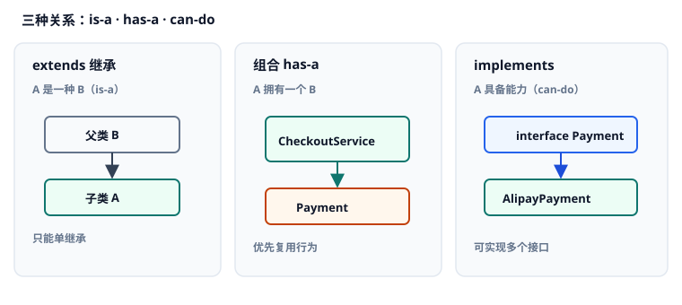
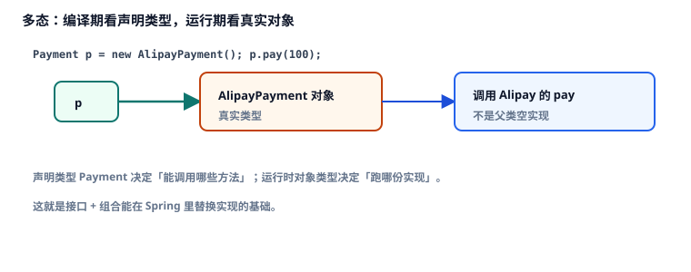

# 2. 面向对象深挖

本章讨论 Java 如何用类协作：<Term id="encapsulation" />、<Term id="inheritance" />与<Term id="composition" />、抽象类与接口、<Term id="polymorphism" />、<Term id="hashcode-contract" />与<Term id="record" />，以及 `static`、重写与重载。

本章不是词条堆砌。六个知识要点按因果排列：先能藏住状态，再选「继承 / 组合 / 接口」，然后才谈抽象骨架与运行期分派；放进集合前必须立住相等契约，最后补上类级成员与方法签名规则。带点状下划线的词可点开释义，见 [术语表](./glossary.md)。

对应代码：[`OopDemo.java`](./src/main/java/com/jffd/core/oop/OopDemo.java)（同包还有 `Payment`、`CheckoutService`、`User`、`UserId` 等）

考点深度对齐吸收自 [JavaGuide · Java 基础](https://javaguide.cn/java/basis/java-basic-questions-01.html) 等篇；反射 / 动态代理仅作外链（Apache-2.0）。

| | |
|--|--|
| 前置 | 第 1 章：引用类型、`==` 与 `equals`、<Term id="value-passing" />。 |
| 学完应能 | 用 `private` 封装字段；用接口 + 组合表达策略并说明为何优先于深继承；区分抽象类与接口；正确重写 `equals`/`hashCode`；说明 `record` 适合什么。 |

---

## 知识要点一：封装与访问修饰符

第 1 章你已经会声明类型、传参。接下来要回答：一个对象的内部数据凭什么不该被外面随便改？

### 1. 概述 (Overview)

在 TypeScript 里，字段默认往往「谁都能摸」；靠约定或 `private` 修饰符约束。后端对象一旦暴露可变字段，订单金额、用户状态很容易在别处被改坏。

<Term id="encapsulation" strong />的意思是：把内部数据藏起来，只通过受控方法对外交互。Java 用访问修饰符规定「谁看得见」。

核心定位：字段默认 `private`；对外开必要的方法，而不是无脑给每个字段生成 setter。

### 2. 底层心智模型 (Mental Model)

把对象想成带柜台的房间：外面只能通过窗口（方法）办事，不能直接翻抽屉（字段）。

| 修饰符 | 同类 | 同包 | 子类 | 其他包 |
|--------|------|------|------|--------|
| `private` | 可以 | 不可以 | 不可以 | 不可以 |
| 默认（包私有） | 可以 | 可以 | 不可以* | 不可以 |
| `protected` | 可以 | 可以 | 可以 | 不可以 |
| `public` | 可以 | 可以 | 可以 | 可以 |

\*子类若在别的包，也看不到父类的包私有成员。

### 3. 语法与核心 API 签名 (Syntax & Parameters)

```java
public class User {
    private final long id;      // private：只有本类能直接碰
    private String email;

    public User(long id, String email) {
        this.id = id;
        this.email = email;
    }

    public long getId() { return id; }           // 受控读取
    public String getEmail() { return email; }
}
```

| 关键字 | 此处作用 |
|--------|----------|
| `private` | 成员仅本类可见 |
| `final`（字段） | 构造后不能换绑（引用箭头不能换） |
| `public` 方法 | 对外稳定 API |

### 4. 渐进式示例 (Examples)

#### 示例 1：最小可运行原型

```java
public class EncapsuleProto {
    public static void main(String[] args) {
        User u = new User(1L, "ada@example.com");
        System.out.println("id=" + u.getId() + ", email=" + u.getEmail());
        // u.id = 2; // 编译错误：private
    }
}
```

```text
// 控制台输出：
id=1, email=ada@example.com
```

逐行执行逻辑：

1. 构造时把 `id`、`email` 写入私有字段。  
2. 外面只能通过 getter 读取。  
3. 直接写 `u.id` 编不过——封装在编译期生效。

#### 示例 2：真实业务——已支付订单不允许改金额

```java
final class Order {
    private final long id;
    private int amountCents;
    private boolean paid;

    Order(long id, int amountCents) {
        this.id = id;
        this.amountCents = amountCents;
    }

    void markPaid() { this.paid = true; }

    void changeAmount(int cents) {
        if (paid) {
            throw new IllegalStateException("paid order immutable");
        }
        this.amountCents = cents;
    }

    int amountCents() { return amountCents; }
}

public class OrderGuard {
    public static void main(String[] args) {
        Order o = new Order(9L, 1000);
        o.changeAmount(1200);
        System.out.println("amount=" + o.amountCents());
        o.markPaid();
        try {
            o.changeAmount(1);
        } catch (IllegalStateException e) {
            System.out.println("blocked: " + e.getMessage());
        }
    }
}
```

```text
// 控制台输出：
amount=1200
blocked: paid order immutable
```

逐行执行逻辑：

1. 未支付时可改金额。  
2. `markPaid` 后状态改变。  
3. 再改金额被方法拦住——不变量由封装守住，而不是靠调用方自觉。

### 5. 常见错误与避坑指南 (Common Pitfalls)

#### 错误写法：字段 public

```java example-bad
public int amountCents; // 谁都能改
```

#### 正确写法

```java example-good
private int amountCents;
public int amountCents() { return amountCents; }
```

根因：公开字段等于放弃不变量。

---

#### 错误写法：每个字段无脑 setter

已支付金额、创建时间等往往不该有 setter。

### 6. 前端 vs Java 快速对照表 (Comparison)

| 维度 | TypeScript | Java |
|------|------------|------|
| 隐藏字段 | `private` / `#field` | `private` 字段 + 方法 |
| 对外 API | export 的方法/类型 | `public` 方法 |
| 同模块协作 | 模块边界 | 包私有 / `protected` |

---

状态藏住了，下一个问题是：类与类之间用「是一种」「拥有」「具备能力」哪一种关系连接？

## 知识要点二：继承、组合与接口

### 1. 概述 (Overview)

前端组件常用「组合」：大组件拥有子组件。Java 里若滥用 `extends` 堆出深继承树，父类一改，子类行为可能静默变样（脆弱基类）。

三种关系：

1. <Term id="inheritance" strong />（`extends`）：A **是一种** B（is-a），单继承。  
2. <Term id="composition" strong />（字段）：A **拥有** B（has-a）。  
3. 接口（`implements`）：A **具备** 某种能力（can-do），可多实现。

核心定位：复用行为优先「接口 + 组合」；真正浅树 is-a 才 `extends`。

### 2. 底层心智模型 (Mental Model)



结账服务**拥有**支付能力，而不是「结账是一种支付」。换成 Spring，构造器注入就是组合：`OrderService(OrderRepository repo, PaymentGateway gw)`。

### 3. 语法与核心 API 签名 (Syntax & Parameters)

```java
public interface Payment {
    void pay(int cents);
}

public class AlipayPayment implements Payment {
    @Override
    public void pay(int cents) { /* ... */ }
}

final class CheckoutService {
    private final Payment payment; // 组合：依赖接口

    CheckoutService(Payment payment) {
        this.payment = payment;
    }

    void checkout(int cents) {
        payment.pay(cents);
    }
}
```

| 关键字 | 作用 |
|--------|------|
| `interface` | 声明能力契约 |
| `implements` | 类承诺实现接口 |
| `extends` | 继承一个父类 |
| `@Override` | 标明重写；签名写错会编译失败 |

### 4. 渐进式示例 (Examples)

#### 示例 1：最小可运行原型

```java
public class ComposeProto {
    public static void main(String[] args) {
        CheckoutService s = new CheckoutService(cents ->
            System.out.println("pay " + cents));
        s.checkout(100);
    }
}
```

```text
// 控制台输出：
pay 100
```

（Demo 里用具体 `AlipayPayment` / `WechatPayment` 类，效果相同。）

#### 示例 2：真实业务——换支付渠道不必改结账类

```java
CheckoutService alipay = new CheckoutService(new AlipayPayment());
alipay.checkout(5000);

CheckoutService wechat = new CheckoutService(new WechatPayment());
wechat.checkout(5000);
```

```text
// 控制台输出（示意，以 Demo 为准）：
[Alipay] pay 5000
[Wechat] pay 5000
```

逐行执行逻辑：只换构造器传入的实现；`CheckoutService` 源码不动。

### 5. 常见错误与避坑指南 (Common Pitfalls)

#### 错误写法：为复用代码深继承

```java example-bad
class OrderService extends AlipayPayment { } // 结账不是一种支付宝
```

#### 正确写法

```java example-good
class OrderService {
    private final Payment payment;
    OrderService(Payment payment) { this.payment = payment; }
}
```

根因：is-a 不成立时硬继承，后面换渠道要改继承树。

### 6. 前端 vs Java 快速对照表 (Comparison)

| 维度 | 前端直觉 | Java |
|------|----------|------|
| 组合 | 组件嵌套 / hooks 注入 | 字段持有依赖 |
| 多能力 | 多接口 / mixin 思想 | 多 `implements` |
| 单继承 | 类继承少用 | `extends` 仅一父类 |

---

关系选对了，有时还需要「流程固定、步骤可填」或「只声明能力」——抽象类与接口如何分工？

## 知识要点三：抽象类与接口

### 1. 概述 (Overview)

接口适合对外策略点、SPI、多能力混搭。抽象类适合共享字段与模板流程：骨架写在父类，子类只填差异步骤。

没有抽象类时，模板流程容易在每个子类复制粘贴；没有接口时，调用方只能绑死具体类，难替换实现。

### 2. 底层心智模型 (Mental Model)

模板方法：`notifyUser` 固定顺序——校验 → 格式化 → 发送 → 收尾；子类只实现 `doSend`。

| 需求 | 更倾向抽象类 | 更倾向接口 |
|------|--------------|------------|
| 共享字段 / 受保护状态 | 是 | 否 |
| 同时具备多种能力 | 否（单继承） | 是 |
| 固定算法骨架 | 是 | 较少 |
| 对外 API / 策略点 | 较少 | 是 |

### 3. 语法与核心 API 签名 (Syntax & Parameters)

```java
public abstract class AbstractNotifier {
    public final void notifyUser(String to, String body) {
        validate(to);
        String text = format(body);
        doSend(to, text);
        afterSend(to);
    }

    protected void validate(String to) { /* 默认 */ }
    protected String format(String body) { return body; }
    protected abstract void doSend(String to, String text);
    protected void afterSend(String to) { /* 钩子 */ }
}
```

| 关键字 | 作用 |
|--------|------|
| `abstract class` | 不能直接 `new` |
| `abstract` 方法 | 子类必须实现 |
| `final` 方法 | 子类不能覆写流程骨架 |
| `default`（接口方法） | Java 8+ 接口可带默认实现，但仍不宜堆状态 |

### 4. 渐进式示例 (Examples)

#### 示例 1：最小可运行原型

```java
public class TemplateProto {
    public static void main(String[] args) {
        AbstractNotifier n = new SmsNotifier();
        n.notifyUser("u-1", "shipped");
    }
}
```

```text
// 控制台输出（示意）：
[Sms] to=u-1 body=shipped
```

#### 示例 2：真实业务——同一通知流程，换短信 / 邮件实现

子类只覆写 `doSend`；运营改文案格式可改父类 `format`，所有渠道一起受益。

### 5. 常见错误与避坑指南 (Common Pitfalls)

#### 错误写法：接口当「带一堆字段的基类」

接口不宜模拟抽象类的可变状态。

#### 错误写法：抽象类上堆与业务无关的工具方法

工具方法放工具类或独立组件，保持抽象类职责单一。

### 6. 前端 vs Java 快速对照表 (Comparison)

| 维度 | TS | Java |
|------|-----|------|
| 接口 | `interface` 结构类型为主 | 名义类型，需 `implements` |
| 抽象类 | `abstract class` | 同左，单继承 |
| 默认实现 | 少见 | 接口 `default` / 抽象类已实现方法 |

---

骨架与契约有了，运行时如何「同一个类型变量、不同实现」？

## 知识要点四：多态

### 1. 概述 (Overview)

<Term id="polymorphism" strong />：用父类型 / 接口类型的变量，指向子类型对象；编译期按左边检查能调什么，运行期按右边实际对象执行哪段代码。

没有多态，换支付渠道就要改遍所有 `if-else`；有了多态，调用方只依赖 `Payment`。

### 2. 底层心智模型 (Mental Model)



```text
Payment pay = new AlipayPayment();
pay.pay(100);
     │
     └─ 编译期：pay 是 Payment，只能调 Payment 上的方法
     └─ 运行期：实际对象是 AlipayPayment → 进入其 pay 实现
```

### 3. 语法与核心 API 签名 (Syntax & Parameters)

```java
Payment pay = new AlipayPayment();
pay.pay(100);

List<Payment> all = List.of(new AlipayPayment(), new WechatPayment());
for (Payment p : all) {
    p.pay(1999); // 每次按真实类型分派
}
```

### 4. 渐进式示例 (Examples)

#### 示例 1：最小可运行原型

见上：同一 `Payment` 引用，构造时传入不同实现。

#### 示例 2：真实业务——策略列表

Spring 常注入 `List<Handler>`，运行期逐个调用——基础就是多态。模块三会再见到。

```text
// OopDemo 控制台示意：
[Alipay] pay 1999
[Wechat] pay 1999
```

### 5. 常见错误与避坑指南 (Common Pitfalls)

#### 错误写法：用一长串 `instanceof` 代替接口

优先让新类型实现接口，而不是每次加分支。

#### 错误写法：子类重写时不加 `@Override`

签名写错会变成新重载，运行期仍走父类——加上 `@Override` 让编译器拦住。

### 6. 前端 vs Java 快速对照表 (Comparison)

| 维度 | TS | Java |
|------|-----|------|
| 运行期分派 | 原型链 / 对象方法 | 虚方法表（了解即可） |
| 面向接口 | duck typing / 接口 | 显式 `implements` |

---

对象要放进 `HashSet` / 当 `HashMap` 键时，光有引用相等不够——必须立住内容相等契约。

## 知识要点五：`equals`、`hashCode` 与 `record`

### 1. 概述 (Overview)

第 1 章：`==` 比对引用；内容比用 `equals`。<Term id="hashcode-contract" strong />要求：`equals` 为 true 则 `hashCode` 必须相等，否则进哈希集合会「明明相等却找不到」。

<Term id="record" strong />（Java 16+）适合不可变数据载体：编译器生成构造器、访问器、`equals`、`hashCode`、`toString`。

### 2. 底层心智模型 (Mental Model)

1. `equals`：自反、对称、传递、一致；对 `null` 返回 false。  
2. `equals` true ⇒ `hashCode` 相同。  
3. `hashCode` 相同不一定 `equals`（冲突正常）。  
4. 参与二者的字段放入集合后不要再改。  
5. 实体常按业务主键比；`id == null` 的临时对象慎入 Set/Map。

### 3. 语法与核心 API 签名 (Syntax & Parameters)

```java
@Override
public boolean equals(Object o) {
    if (this == o) return true;
    if (!(o instanceof User user)) return false;
    return Objects.equals(id, user.id);
}

@Override
public int hashCode() {
    return Objects.hash(id);
}

public record UserId(long value) {
    public UserId {
        if (value <= 0) throw new IllegalArgumentException("must be positive");
    }
}
```

### 4. 渐进式示例 (Examples)

#### 示例 1：最小可运行原型

```java
User a = new User(1L, "a@example.com");
User b = new User(1L, "b@example.com");
System.out.println(a.equals(b));           // true（按 id）
System.out.println(a.hashCode() == b.hashCode()); // true
```

```text
// 控制台输出：
true
true
```

#### 示例 2：真实业务——HashSet 按 id 去重

```java
Set<User> set = new HashSet<>();
set.add(a);
set.add(b);
System.out.println(set.size()); // 1
```

```text
// 控制台输出：
1
```

逐行执行逻辑：同 id 视为同一用户；只重写 `equals` 不重写 `hashCode` 时，size 可能变成 2。

### 5. 常见错误与避坑指南 (Common Pitfalls)

#### 错误写法：只重写 equals

```java example-bad
// hashCode 仍用 Object 默认 → HashMap/HashSet 行为错乱
```

#### 正确写法：`equals` 与 `hashCode` 一起重写，字段集合一致。

---

#### 错误写法：可变字段参与 hashCode 且放入 Map 后再改

见第 3 章可变 key 事故。

### 6. 前端 vs Java 快速对照表 (Comparison)

| 维度 | TS | Java |
|------|-----|------|
| 内容相等 | 常手写 / 深比较库 | `equals` |
| 值对象 | 只读对象 / zod 推断类型 | `record` |
| 作 Map key | 对象引用或字符串化 | 必须满足 hash 契约 |

---

类协作的主干齐了；还差类级成员，以及「同名方法」到底是重写还是重载。

## 知识要点六：`static`、重写与重载

### 1. 概述 (Overview)

`static` 属于类本身，所有实例共享。常量可用 `public static final`；可变 static Map 当全局缓存很容易在并发下出事（细节见模块二）。

重载（overload）：同名不同参数列表。  
重写（override）：子类替换父类 / 接口中同签名方法。

### 2. 底层心智模型 (Mental Model)

| | 重载 | 重写 |
|--|------|------|
| 位置 | 同类或子类新增 | 子类对父类/接口 |
| 签名 | 方法名同，参数列表不同 | 方法名与参数类型序列相同 |
| 目的 | 同语义不同入参 | 特化行为 |

### 3. 语法与核心 API 签名 (Syntax & Parameters)

```java
void print(String s) { }
void print(int n) { }          // 重载

class Child extends Parent {
    @Override
    void run() { }             // 重写
}
```

### 4. 渐进式示例 (Examples)

#### 示例 1：重载

```java
print("hi");
print(42);
```

#### 示例 2：static 常量

```java
public static final String APP = "jffd";
```

可变 static 缓存留给容器单例，不要随手 `static Map`。

### 5. 常见错误与避坑指南 (Common Pitfalls)

#### 错误写法：本想重写却写成重载（参数类型写错）且无 `@Override`

#### 正确写法：一律加 `@Override`。

---

#### 错误写法：`static` 可变 Map 当缓存

生产用 Spring Bean / 专用缓存组件。

### 6. 前端 vs Java 快速对照表 (Comparison)

| 维度 | TS/JS | Java |
|------|-------|------|
| 模块级变量 | 模块作用域 | `static`（更易共享失控） |
| 同名函数 | 无真实重载 | 方法重载 |
| 子类替换 | 原型覆写 | `@Override` 重写 |

---

## 检验一下

1. 字段为什么默认 `private`？  
2. 组合和继承各适合什么关系？脆弱基类指什么？  
3. 抽象类和接口如何选择？  
4. 多态的编译期与运行期各看什么？  
5. 为什么重写 `equals` 必须重写 `hashCode`？  
6. `record` 自动生成了什么？适合什么场景？

---

## 动手

1. 运行：

```bash
mvn -pl 01-Java-Core-And-OOP exec:java "-Dexec.mainClass=com.jffd.core.oop.OopDemo"
```

2. 观察同一 `Payment` 类型、不同实现走不同渠道。  
3. 对照模板方法：`notifyUser` 流程固定，子类只填发送。  
4. 确认替换支付实现不必改 `CheckoutService`。  
5. 确认同 id 的两个 `User` 进 `HashSet` 后 size 为 1；再看 `UserId` record。

---

## 备注：反射与动态代理（深水，Core 不展开）

框架（Spring、MyBatis）大量用到反射与代理。本章只需知道「运行时可以问类有哪些方法、可以生成接口的代理实现」。

- [JavaGuide · 反射](https://javaguide.cn/java/basis/reflection.html)  
- [JavaGuide · 代理模式](https://javaguide.cn/java/basis/proxy.html)

---

## 面试（可选）

- 抽象类和接口？Java 8 的 default/static 方法之后呢？  
- 重写 `equals` 为什么必须重写 `hashCode`？契约还有哪些？  
- 组合优于继承的常见理由？  
- 多态如何分派（了解虚方法表即可）？  
- 重写与重载的区别？  
- （加分）反射、JDK 动态代理、CGLIB 分别干什么？

参考：[JavaGuide · Java 基础常见题](https://javaguide.cn/java/basis/java-basic-questions-01.html)

## 小结

六个知识要点连成一条因果链：封装藏状态 → 组合/接口选关系 → 抽象类定骨架 → 多态按实际对象分派 → equals/hashCode 契约与 record → static 与重写/重载。下一章专门讲集合本身。

下一章 → [03-collections-framework.md](./03-collections-framework.md)
