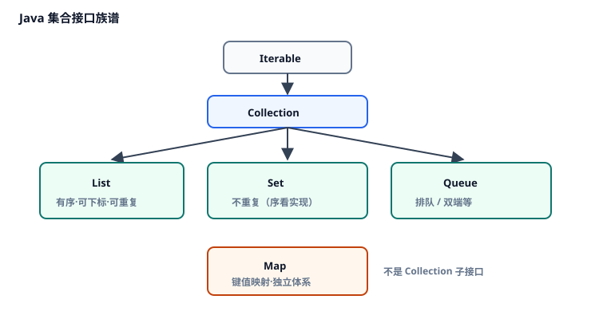
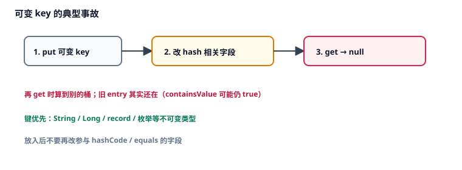

# 3. 集合框架

本章讨论 Java 如何组织一堆对象：`List` / `Set` / `Queue` / `Map` 族谱，<Term id="arraylist" />与<Term id="hashmap" />的选型与机制，以及遍历时的 <Term id="fail-fast" />、不可变返回值和常见误用。

本章不是 API 词典。五个知识要点按因果排列：先认清接口族谱，再精通 List 与 Map 两条主干，然后补 Set 与队列，接着处理遍历修改，最后收口返回值与生产踩坑。带点状下划线的词可点开释义，见 [术语表](./glossary.md)。

对应代码：[`CollectionsDemo.java`](./src/main/java/com/jffd/core/collections/CollectionsDemo.java)

机制结论吸收自 [JavaGuide · 集合](https://javaguide.cn/java/collection/java-collection-questions-01.html)、[使用注意事项](https://javaguide.cn/java/collection/java-collection-precautions-for-use.html) 等篇，已按本仓库 MDN 六段式重写（Apache-2.0）。完整源码逐行不在本章展开。

| | |
|--|--|
| 前置 | 第 1–2 章：引用类型、<Term id="hashcode-contract" />、为何是 `List<Integer>`。 |
| 学完应能 | 画出 Collection / Map 族谱；说明 ArrayList 扩容与 HashMap 桶查找；解释 fail-fast 与可变 key；避开 `Arrays.asList` 等坑；空集合不返回 null。 |

---

## 知识要点一：集合接口族谱与面向接口编程

上一章你已经会用类协作。接下来要回答：后端天天装「一串用户 / 一堆配置」时，该拿哪种容器？

### 1. 概述 (Overview)

TypeScript 里常见 `Array` 与 `Map`/`Set`。Java 把「可遍历的一堆元素」和「键到值的映射」拆成两支接口族，并强调：**变量类型写接口，右边再 new 实现类**——换实现时调用方少改。

没有这套分层：业务代码写死 `ArrayList`，测试替身与并发实现都难替换。

核心定位：`Collection`（List / Set / Queue）与独立的 `Map`；日常默认 `ArrayList` + `HashMap`。

### 2. 底层心智模型 (Mental Model)



```text
Collection ── List（有序、可重复）
          ├── Set（不重复）
          └── Queue / Deque（队列）
Map（键 → 值，不是 Collection 子接口）
```

并发容器（如 `ConcurrentHashMap`）放模块二。

### 3. 语法与核心 API 签名 (Syntax & Parameters)

```java
List<String> list = new ArrayList<>();
Map<String, Integer> map = new HashMap<>();
Set<String> set = new HashSet<>();
```

| 写法 | 作用 |
|------|------|
| 左边接口 | 调用方只依赖能力 |
| 右边实现 | 决定性能与语义细节 |
| `<>` 钻石运算符 | 右边类型参数可省略（Java 7+） |

### 4. 渐进式示例 (Examples)

#### 示例 1：最小可运行原型

```java
import java.util.ArrayList;
import java.util.HashMap;
import java.util.List;
import java.util.Map;

public class HierarchyProto {
    public static void main(String[] args) {
        List<String> tags = new ArrayList<>();
        tags.add("java");
        Map<String, Integer> stars = new HashMap<>();
        stars.put("react", 1);
        System.out.println(tags + " / " + stars);
    }
}
```

```text
// 控制台输出：
[java] / {react=1}
```

#### 示例 2：真实业务——Service 入参用接口

```java
void export(List<String> rows) { /* 不写 ArrayList 参数 */ }
```

测试时可传入 `List.of(...)` 或自定义 List，无需继承 `ArrayList`。

### 5. 常见错误与避坑指南 (Common Pitfalls)

#### 错误写法：方法签名写死实现类

```java example-bad
void export(ArrayList<String> rows) { }
```

#### 正确写法

```java example-good
void export(List<String> rows) { }
```

### 6. 前端 vs Java 快速对照表 (Comparison)

| 维度 | TypeScript | Java |
|------|------------|------|
| 列表 | `T[]` / `Array<T>` | `List<T>`（常用 ArrayList） |
| 映射 | `Map` / 对象 | `Map<K,V>` |
| 去重 | `Set` | `Set` / `HashSet` |
| 面向接口 | 类型别名 / 接口 | 变量与参数写接口类型 |

---

族谱清楚了，业务里 80% 的列表是 ArrayList——它的代价与扩容必须建立直觉。

## 知识要点二：`List` 与 `ArrayList`

### 1. 概述 (Overview)

`List` 是有序列表：可按下标访问，允许重复元素。业务默认实现是 <Term id="arraylist" strong />——底层可扩容数组。

没有预估容量时，频繁扩容会拷贝数组；在中间插入会搬移元素。链表 `LinkedList` 理论头尾插入好看，但缓存不友好，业务很少用；队列语义优先 `ArrayDeque`。

### 2. 底层心智模型 (Mental Model)


扩容结论：

1. 内部是 `Object[]`；满了再分配更大数组并拷贝。  
2. 尾部 `add` 大多快，偶尔扩容会抖一下。  
3. `new ArrayList<>(expectedSize)` 可减少拷贝。  
4. 判空用 `isEmpty()`，不要习惯性 `size() == 0`。

| 操作 | 大致复杂度 | 说明 |
|------|------------|------|
| 尾部 `add` | 摊还 O(1) | 偶尔扩容 |
| 中间 `add` / `remove` | O(n) | 搬移 |
| `get(i)` | O(1) | 下标 |
| `contains` | O(n) | 扫描 |

### 3. 语法与核心 API 签名 (Syntax & Parameters)

```java
List<String> list = new ArrayList<>(256);
list.add("a");
list.add(1, "b");      // 中间插入
String first = list.get(0);
list.removeIf(s -> s.equals("b"));
boolean empty = list.isEmpty();
```

### 4. 渐进式示例 (Examples)

#### 示例 1：最小可运行原型

```java
List<String> frameworks = new ArrayList<>(4);
frameworks.add("React");
frameworks.add("Vue");
frameworks.add(1, "Svelte");
System.out.println(frameworks);
System.out.println(frameworks.get(0));
```

```text
// 控制台输出：
[React, Svelte, Vue]
React
```

#### 示例 2：真实业务——批量导入预分配

前端传来约 500 行 CSV：`new ArrayList<>(512)`，减少扩容次数，导入更稳。

### 5. 常见错误与避坑指南 (Common Pitfalls)

#### 错误写法：大列表用 `contains` 去重

```java example-bad
if (!result.contains(x)) result.add(x); // O(n²) 风险
```

#### 正确写法：用 `HashSet` 去重。

---

#### 错误写法：默认选用 `LinkedList`「因为插入快」

业务随机访问多，默认 `ArrayList`；真要队列用 `ArrayDeque`。

### 6. 前端 vs Java 快速对照表 (Comparison)

| 维度 | TS Array | ArrayList |
|------|----------|-----------|
| 下标访问 | O(1) | O(1) |
| 尾部 push | 常见 | `add` |
| 中间 splice | 要搬移 | 要搬移 |
| 定长 | 可 length 约定 | 另有数组 `T[]` |

---

列表会了，键值查找靠 Map——HashMap 的桶与键契约是集合章的硬核。

## 知识要点三：`Map` 与 `HashMap`

### 1. 概述 (Overview)

`Map` 保存键到值的映射。最常用实现是 <Term id="hashmap" strong />。键的相等性依赖第 2 章的 `equals`/`hashCode` 契约；键放入后改字段，可能「丢数据」。

`HashMap` **不是**线程安全的；多线程写入用 `ConcurrentHashMap`（模块二）。

### 2. 底层心智模型 (Mental Model)


查找步骤：

1. 算 `hashCode`（再扰动）→ 桶下标。  
2. 桶内链表 / 树里用 `equals` 比键。  
3. 元素过多超过「负载因子 × 容量」（默认 **0.75**）时扩容（容量多为 2 的幂）。  
4. 经验阈值：链表长度 ≥ **8** 且数组长度 ≥ **64** 时可能树化。

可变键事故：



键优先：`String`、`Long`、`record`、枚举等不可变类型。

### 3. 语法与核心 API 签名 (Syntax & Parameters)

```java
Map<String, Integer> stars = new HashMap<>();
stars.put("react", 220_000);
stars.putIfAbsent("vue", 1);
int v = stars.getOrDefault("angular", 0);
boolean has = stars.containsKey("react");
```

| API | 作用 |
|-----|------|
| `put` / `putIfAbsent` | 放入 / 仅当不存在时放入 |
| `get` | 可能 null：无键或值就是 null |
| `getOrDefault` | 避免一手 null |
| `containsKey` | 区分「没键」 |

### 4. 渐进式示例 (Examples)

#### 示例 1：最小可运行原型

```java
Map<String, Integer> stars = new HashMap<>();
stars.put("react", 220_000);
stars.putIfAbsent("vue", 210_000);
System.out.println(stars.getOrDefault("angular", 0));
```

```text
// 控制台输出：
0
```

#### 示例 2：真实业务——可变 key 踩坑（对照 Demo）

```java
// 修改参与 hashCode 的字段后：
System.out.println(map.get(key)); // 常为 null
```

```text
// CollectionsDemo 会打印 before/after get 差异
```

### 5. 常见错误与避坑指南 (Common Pitfalls)

#### 错误写法：忽略 `get` 的 null 歧义

```java example-bad
Integer v = map.get(k);
if (v == null) { /* 到底是没键还是值就是 null？ */ }
```

#### 正确写法：`containsKey` / 禁止存 null 值 / `getOrDefault`。

---

#### 错误写法：多线程同时写 HashMap

改用 `ConcurrentHashMap`（模块二）。

### 6. 前端 vs Java 快速对照表 (Comparison)

| 维度 | TS Map / 对象 | HashMap |
|------|---------------|---------|
| 键类型 | 多种 | 任意对象（需契约） |
| 缺键 | `undefined` | 常为 `null` |
| 并发 | 单线程为主 | 需并发实现 |

---

List/Map 主干之外，去重与队列也要会选。

## 知识要点四：`Set` 与其他常用实现

### 1. 概述 (Overview)

`Set` 表示不重复元素；`HashSet` 内部通常靠 `HashMap` 的键去重。需要插入序用 `LinkedHashSet` / `LinkedHashMap`；要排序用 `TreeMap`；双端队列用 `ArrayDeque`（不要用过时的 `Stack` 类）。

### 2. 底层心智模型 (Mental Model)

| 类型 | 特征 | 典型用途 |
|------|------|----------|
| `HashSet` | 去重 | 唯一集合 |
| `LinkedHashSet` | 去重且插入序 | 唯一且要顺序 |
| `LinkedHashMap` | 插入序 / 可访问序 | 有序 Map；简易 LRU |
| `TreeMap` | 按键排序 | 范围查询 |
| `ArrayDeque` | 双端队列 | 队列、栈 |

### 3. 语法与核心 API 签名 (Syntax & Parameters)

```java
Set<String> tags = new HashSet<>();
tags.add("java");
tags.add("java"); // size 仍为 1

Map<String, String> ordered = new LinkedHashMap<>();
ordered.put("first", "1");
```

### 4. 渐进式示例 (Examples)

#### 示例 1：去重

```java
Set<String> tags = new HashSet<>();
tags.add("java");
tags.add("java");
tags.add("ts");
System.out.println(tags.size()); // 2
```

```text
// 控制台输出：
2
```

#### 示例 2：LinkedHashMap 保插入序

```java
System.out.println(ordered.keySet()); // [first, second, third]
```

### 5. 常见错误与避坑指南 (Common Pitfalls)

#### 错误写法：用 `Stack` 类

#### 正确写法：`ArrayDeque` 做栈/队列。

### 6. 前端 vs Java 快速对照表 (Comparison)

| 维度 | TS | Java |
|------|-----|------|
| Set | `Set` | `HashSet` 等 |
| 保序 Map | 插入序对象 / Map | `LinkedHashMap` |

---

容器会用了，遍历时改结构却会炸——fail-fast 与返回值约定必须单独立住。

## 知识要点五：遍历 fail-fast、不可变返回与常见误用

### 1. 概述 (Overview)

增强 for 里直接 `list.remove` 常抛 <Term id="cme" text="ConcurrentModificationException（CME）" strong />。这叫 <Term id="fail-fast" strong />：尽快失败。单线程也会触发。

另外：`Arrays.asList` 不是可增长 `ArrayList`；接口「没数据」应返回空集合而不是 `null`；`subList` 是视图不是深拷贝。

### 2. 底层心智模型 (Mental Model)

增强 for 底层是迭代器；你调用集合自己的 `remove`，迭代器发现结构被改，立刻 CME。正确做法：`removeIf` 或迭代器自己的 `remove`。

### 3. 语法与核心 API 签名 (Syntax & Parameters)

```java
List<String> list = new ArrayList<>(List.of("a", "b", "c"));
list.removeIf(s -> s.equals("b"));

List<String> freeze = List.of("x", "y");
List<String> mutable = new ArrayList<>(Arrays.asList("a", "b"));

String[] arr = list.toArray(new String[0]);
```

### 4. 渐进式示例 (Examples)

#### 示例 1：removeIf

```java
List<String> list = new ArrayList<>(List.of("a", "b", "c", "b"));
list.removeIf(s -> s.equals("b"));
System.out.println(list);
```

```text
// 控制台输出：
[a, c]
```

#### 示例 2：`Arrays.asList` 踩坑

```java example-bad
List<String> list = Arrays.asList("a", "b");
list.add("c"); // UnsupportedOperationException
```

```java example-good
List<String> list = new ArrayList<>(Arrays.asList("a", "b"));
list.add("c");
```

### 5. 常见错误与避坑指南 (Common Pitfalls)

#### 错误写法：增强 for 里 `list.remove`

```java example-bad
for (String s : list) {
    if (s.equals("b")) list.remove(s);
}
```

#### 正确写法：`list.removeIf(...)`。

---

#### 错误写法：返回 `null` 表示空列表

#### 正确写法：`return List.of();`

---

#### 错误写法：`Arrays.asList(new int[]{1,2,3})` 期望三个元素

得到的是「一个元素 = 整个 int 数组」。用 `Integer[]` 或手工装箱。

### 6. 前端 vs Java 快速对照表 (Comparison)

| 维度 | TS | Java |
|------|-----|------|
| 遍历中删除 | 谨慎下标 / filter 新数组 | `removeIf` / 迭代器 |
| 空列表 | `[]` | `List.of()`，别 `null` |
| 数组转列表 | `[...arr]` | `new ArrayList<>(Arrays.asList(...))` 或 Stream |

---

## 检验一下

1. 为什么变量类型写 `List` 而不是 `ArrayList`？  
2. ArrayList 扩容大致在干什么？为何预分配？  
3. HashMap 何时扩容？树化大致条件？  
4. 为什么 Map 键要正确的 `equals`/`hashCode`？  
5. CME 何时出现？正确删除方式？  
6. 为什么 `Arrays.asList` 上 `add` 会炸？  
7. 接口返回空列表为何优于 `null`？

---

## 动手

1. 运行：

```bash
mvn -pl 01-Java-Core-And-OOP exec:java "-Dexec.mainClass=com.jffd.core.collections.CollectionsDemo"
```

2. 观察可变 key：修改后 `get` 变 null，`containsValue` 仍可能为 true。  
3. 试 `Arrays.asList("a").add("b")`，看异常类型。  
4. 把文档「示例 1」抄进临时类跑通。

---

## 面试（可选）

- `ArrayList` 与 `LinkedList`？扩容？  
- `HashMap` 结构、`put`、扩容、树化？  
- `HashMap` 与 `ConcurrentHashMap`？（模块二）  
- fail-fast 与 fail-safe？  
- `hashCode` / `equals` 如何影响 `HashMap`？  
- `LinkedHashMap` 如何做简易 LRU？  
- `Arrays.asList` 有哪些坑？

参考：[JavaGuide · 集合面试题](https://javaguide.cn/java/collection/java-collection-questions-01.html)、[使用注意事项](https://javaguide.cn/java/collection/java-collection-precautions-for-use.html)、[ArrayList 源码](https://javaguide.cn/java/collection/arraylist-source-code.html)、[HashMap 源码](https://javaguide.cn/java/collection/hashmap-source-code.html)

## 小结

五个知识要点连成一条因果链：接口族谱 → ArrayList → HashMap 与键契约 → Set/队列选型 → fail-fast 与返回值/误用。下一章解释 `List<String>` 这种尖括号在编译期和运行期分别意味着什么。

下一章 → [04-generics.md](./04-generics.md)
