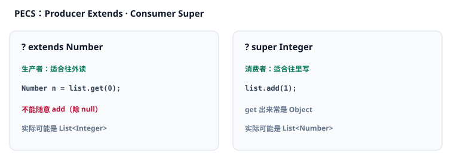
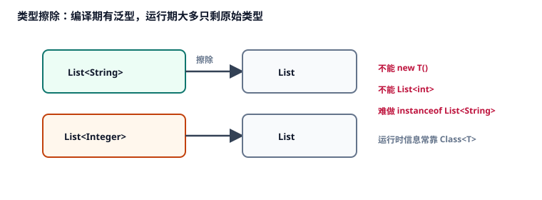

# 4. 泛型

本章讨论 Java <Term id="generics" />：为什么需要它、如何声明泛型类与方法、<Term id="wildcard" />与 <Term id="pecs" />、<Term id="type-erasure" />带来的限制，以及边界和数组的差异。带点状下划线的词可点开释义，见 [术语表](./glossary.md)。

对应代码：[`GenericsDemo.java`](./src/main/java/com/jffd/core/generics/GenericsDemo.java)

深度对齐吸收自 [JavaGuide · 泛型与通配符](https://javaguide.cn/java/basis/generics-and-wildcards.html)，已按本仓库节奏重写（Apache-2.0）。

| | |
|--|--|
| 前置 | 会写 `List<String>`；知道类型参数必须是引用类型（第 1、3 章）。 |
| 学完应能 | 声明泛型类/方法；用 PECS 读/写通配符；解释类型擦除及不能 `new T()` / `List<int>` 的原因；说出 JSON/`TypeReference` 为何要补运行时信息。 |

本章把「泛型本身」拆开讲清楚，按顺序读。

---

## 4.1 没有泛型时会发生什么

早期集合不带元素类型信息：

```java
List list = new ArrayList();
list.add("x");
list.add(1);
String s = (String) list.get(1); // 运行时 ClassCastException
```

错误被推迟到运行期，而且要靠强制转换。

有了泛型之后，元素类型在编译期就被约束：

```java
List<String> list = new ArrayList<>();
list.add("x");
// list.add(1); // 编译失败
```

右边可以用钻石操作符 `<>`，让编译器推断类型参数：

```java
Map<String, List<Integer>> map = new HashMap<>();
```

---

## 4.2 泛型类、泛型方法

**泛型类**：在类名后声明类型参数。

```java
public class Box<T> {
    private T value;
    public void set(T value) { this.value = value; }
    public T get() { return value; }
}
```

**泛型方法**：类型参数写在返回类型前面，属于「这个方法自己的」参数，可以和类上的 `<T>` 无关。

```java
public static <T> T first(List<T> list) {
    return list.isEmpty() ? null : list.get(0);
}
```

命名习惯：`T` 类型、`E` 元素、`K`/`V` 键值、`R` 返回值。  
后端常见形态：`Result<T>`、`Page<T>`、`Repository<T, ID>`、`ApiResponse<T>`。

---

## 4.3 不变性、通配符与 PECS

Java 泛型默认是**不变**（invariant）的：`List<Integer>` **不是** `List<Number>` 的子类型。

```java
List<Integer> ints = List.of(1, 2);
// List<Number> nums = ints; // 编译错误
```

若允许这样赋值，就可能往「以为是 Number 的列表」里塞入 `Double`，破坏 `Integer` 列表。

数组则不同：数组是协变的，但不安全：

```java
Number[] arr = new Integer[2];
arr[0] = 1.5; // 编译通过，运行期 ArrayStoreException
```

为了在「只读」或「只写」场景表达有限的灵活性，Java 提供通配符。口诀 **PECS**：Producer Extends, Consumer Super。



### `? extends`：生产者（上界通配）

```java
static double sum(List<? extends Number> source) {
    double total = 0;
    for (Number n : source) {
        total += n.doubleValue();
    }
    // source.add(1); // 不行：实际可能是 List<Double>
    return total;
}
```

你可以从中**读成**上界类型（这里是 `Number`），但通常不能往里随意 `add`。

### `? super`：消费者（下界通配）

```java
static void fill(List<? super Integer> sink) {
    sink.add(10);
    // Integer x = sink.get(0); // 不行：实际可能是 List<Object>
}
```

你可以往里**写入**下界类型（这里是 `Integer`），读出来时通常只能当成 `Object`。

### 无界通配 `?`

`List<?>` 表示元素类型未知，几乎只能安全地读成 `Object`，不能随意添加（除 `null` 等少数情况）。

口诀：**PECS** — Producer Extends，Consumer Super。  
需要「读一堆 Number 子类型」用 `? extends`；需要「写入 Integer」用 `? super`。

记法对照前端：TS 里协变/逆变写在类型参数位置上；Java 默认不变，只能用通配符在**使用处**打开有限的读/写灵活度。不要指望 `List<Dog>` 直接当 `List<Animal>` 用。

---

## 4.4 类型擦除

**类型擦除**的意思是：泛型主要在编译期检查；编译之后，类型参数基本消失，运行时看到的是原始类型（raw type），并插入必要的强制转换。



因此有一批硬限制：

- 不能 `new T()`、`new T[10]`  
- 不能写 `List<String>.class`（没有「带参数的 Class 字面量」）  
- 不能 `catch (T e)`  
- 运行时不能可靠地做 `instanceof List<String>`  
- 不能写 `List<int>`：类型参数必须是引用类型（见 [第 1 章](./01-strong-typing-and-basics.md)）

历史因果：泛型加入前集合只装 `Object`；为兼容旧字节码采用擦除，而不是像部分语言那样保留完整运行时泛型。

需要在运行时知道具体类型时，常把 `Class<T>` 当作令牌传入：

```java
public static <T> T create(Class<T> type) throws Exception {
    return type.getDeclaredConstructor().newInstance();
}
String s = create(String.class);
```

JSON 反序列化泛型时，框架常用 `TypeReference<List<User>>`（Jackson）之类手段，靠匿名子类保留泛型签名，补回运行时信息（模块三再细讲）。这是擦除在后端最常见的「必须绕一下」的地方。

桥接方法：擦除后为了保持多态，编译器可能生成合成方法。面试提到「擦除 + 桥接」即可，不必背字节码细节。

---

## 4.5 类型边界

可以限制类型参数必须满足某些约束：

```java
public static <T extends Comparable<T>> T max(T a, T b) {
    return a.compareTo(b) >= 0 ? a : b;
}
```

多界写法：`<T extends Animal & Serializable & Comparable<T>>`。若有类，类必须写在第一位，其余为接口。

---

## 4.6 泛型与数组如何选择

| | 数组 | 泛型集合 |
|--|------|----------|
| 子类型关系 | 协变 | 默认不变 |
| 运行时元素类型 | 记得较清楚 | 擦除后变模糊 |
| 典型风险 | `ArrayStoreException` | 编译期拦住更多错误 |

业务容器优先 `List<T>`。看到 `unchecked` 警告时，先设法消掉，不要无脑 `@SuppressWarnings`。

---

## 4.7 在后端代码里你会怎么碰到擦除

1. 反射拿到的字段类型可能已是擦除后的信息，框架靠额外元数据补全。  
2. JSON 反序列化必须明确告诉框架：这是 `List<User>`，不是原始 `List`。  
3. 公共 API 不要返回原始类型 `List`，会把不安全扩散给调用方。

---

## 检验一下

1. 为什么不能写 `List<int>`？和类型擦除有什么关系？  
2. 为什么 `List<Integer>` 不能直接当成 `List<Number>`？  
3. PECS 分别解决读和写哪一边？  
4. 为什么不能 `new T()`？常见绕法是什么？  
5. 数组协变和泛型不变，哪个更容易在运行期出问题？  
6. `ApiResponse<T>` 为什么适合做成泛型？

---

## 动手

1. 运行：

```bash
mvn -pl 01-Java-Core-And-OOP exec:java -Dexec.mainClass="com.jffd.core.generics.GenericsDemo"
```

2. 对照 `Box`、`ApiResponse`、`sum(? extends)`、`fill(? super)`、`Class<T>` 工厂。

---

## 避坑

1. 原始类型 `List` 与 `List<String>` 混用  
2. 随意 `@SuppressWarnings("unchecked")`  
3. 返回 `List<?>` 导致调用方几乎无法添加元素  
4. 强行创建泛型数组  
5. 以为运行时还能区分 `List<String>` 和 `List<Integer>`

## 面试（可选）

- 什么是类型擦除？有哪些限制？为何不能 `List<int>`？  
- `? extends` 与 `? super`？PECS？  
- 泛型与数组的差异？  
- 如何获取泛型的运行时类型信息？（`Class<T>` / `TypeReference`）  
- 桥接方法是什么？（加分）

参考：[JavaGuide · 泛型与通配符](https://javaguide.cn/java/basis/generics-and-wildcards.html)

## 小结

泛型把类型错误尽量提前到编译期；通配符用 PECS 表达只读或只写；运行时类型参数基本擦掉，所以有一批「不能做」的硬限制。下一章用这些集合与泛型，搭 Stream 管道。

下一章 → [05-stream-and-lambda.md](./05-stream-and-lambda.md)
