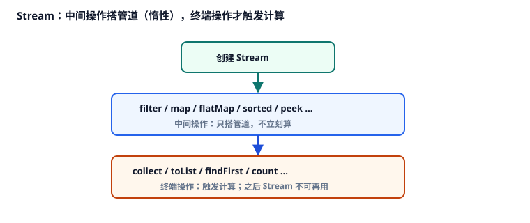

# 5. Stream 与 Lambda

本章讨论 Java 的 <Term id="lambda" />、函数式接口，以及 <Term id="stream" /> 管道：中间操作与终端操作、<Term id="lazy" />、`collect`、`map`/`flatMap`，还有并行流的适用边界。带点状下划线的词可点开释义，见 [术语表](./glossary.md)。

对应代码：[`StreamDemo.java`](./src/main/java/com/jffd/core/stream/StreamDemo.java)

常见误用与考点对齐吸收自 JavaGuide 集合 / Java 8 相关篇目与生产踩坑，已按本仓库节奏重写。

| | |
|--|--|
| 前置 | 会写 `for` 与集合遍历；第 3–4 章的 `List` / 泛型基础。 |
| 学完应能 | 写出 filter/map/collect 管道；解释惰性与短路；说明 Stream 不可复用；知道何时不要用 `parallelStream`；处理 Lambda 里的受检异常。 |

若写过数组的 `map`/`filter` 会更容易上手，仍请按顺序建立 Java Stream 自己的规则。

---

## 5.1 Lambda 与函数式接口

**Lambda** 是一段可传递的简短行为。在 Java 里，它必须能匹配某个**函数式接口**——即只有一个抽象方法的接口（常用 `@FunctionalInterface` 标注）。

```java
BinaryOperator<Integer> add = (a, b) -> a + b;
Runnable r = () -> System.out.println("hi");
```

**方法引用**是 Lambda 的一种简写，指向已有方法：

```java
list.forEach(System.out::println);
list.stream().map(String::toUpperCase);
```

常见函数式接口：

| 接口 | 形态 | 典型用途 |
|------|------|----------|
| `Function<T,R>` | T → R | `map` |
| `Predicate<T>` | T → boolean | `filter` |
| `Consumer<T>` | T → void | `forEach` |
| `Supplier<T>` | () → T | 懒创建 / 工厂 |
| `UnaryOperator<T>` | T → T | 同型变换 |
| `BinaryOperator<T>` | (T,T) → T | `reduce` |

### 变量捕获

Lambda 可以读取外层局部变量，但该变量必须是 **final** 或**事实上 final**（赋值后不再改）：

```java
int factor = 2;
list.stream().map(x -> x * factor); // 可以
// factor = 3; // 若再改，上面的捕获就不合法
```

---

## 5.2 什么是 Stream

**Stream** 是对数据序列的一次性处理管道。你先描述要做什么（过滤、映射、排序……），再在终端操作时真正计算。

```java
List<String> result = users.stream()
    .filter(u -> u.age() >= 18)
    .map(UserView::name)
    .sorted()
    .toList(); // Java 16+；更早写法：collect(Collectors.toList())
```

先记住三条规则：

1. Stream **用过就废**，不能像集合那样反复拿来 `map`。  
2. **中间操作惰性**：只声明「打算怎么处理」，遇到**终端操作**才真正拉数据、做计算。  
3. `parallelStream()` 使用多线程并行，不是「随便加点速度」的开关。

惰性带来的好处：后面的 `findFirst` / `anyMatch` 可以**短路**，不必扫完全表。坏处：你在中间操作里偷偷打日志 / 写库，时机会变乱——所以中间操作应尽量纯。

---

## 5.3 中间操作与终端操作



```java
List.of(1, 2, 3, 4, 5).stream()
    .filter(n -> {
        System.out.println("filter " + n);
        return n % 2 == 0;
    })
    .map(n -> {
        System.out.println("map " + n);
        return n * n;
    })
    .findFirst();
// 往往不会处理完 1..5：终端操作可短路
```

`peek` 适合调试时观察元素，不建议在生产管道里塞业务副作用。

---

## 5.4 `collect` 与 Collectors

把流收成集合、字符串或分组结果，常用 **`collect`** 和 **`Collectors`**。这是业务代码里最常见的「收口」。

```java
Map<String, Long> countByDept = emps.stream()
    .collect(Collectors.groupingBy(Emp::dept, Collectors.counting()));

Map<String, Integer> salarySum = emps.stream()
    .collect(Collectors.groupingBy(Emp::dept, Collectors.summingInt(Emp::salary)));

String csv = emps.stream()
    .map(Emp::name)
    .collect(Collectors.joining(", "));
```

`groupingBy` 负责按某个键分组，后面可以再接下游收集器做计数、求和等。报表、列表转 Map 时经常用到。

注意：`Collectors.toMap(key, value)` 在 **value 为 null** 时会 NPE；key 冲突未提供 merge 函数时会抛异常。列表字段可能为空时，先过滤或改用更安全的收集方式。

---

## 5.5 `map` 与 `flatMap`

- **`map`**：一个输入对应一个输出，结构层数不变。  
- **`flatMap`**：一个输入对应 0..n 个输出，并把结果摊平一层。

```java
List<Optional<String>> maybe = List.of(Optional.of("React"), Optional.empty());
List<String> names = maybe.stream()
    .flatMap(Optional::stream) // Java 9+
    .toList();
```

---

## 5.6 副作用与并行流

中间操作应尽量没有副作用。写库、发 HTTP、打复杂业务日志，放进 Stream 往往不如普通 `for` 清晰。

**`parallelStream()`** 适合：CPU 密集、无共享可变状态、数据量大到值得支付调度成本。

不适合：数据库 / Redis / HTTP（容易打爆连接池）、往共享 `ArrayList` 里 `add`、事务边界里随意并行。

```java
// 危险：并行线程抢同一个 ArrayList
List<String> sink = new ArrayList<>();
list.parallelStream().forEach(sink::add);

// 让终端收集器帮你汇总
List<String> ok = list.parallelStream().map(String::trim).toList();
```

并行流默认使用 `ForkJoinPool.commonPool()`。线程池细节见模块二。

---

## 5.7 调试与受检异常

Lambda / 方法引用里**不能直接抛受检异常**（除非函数式接口签名本身声明了 `throws`，而标准 `Function` 等没有）。因此 `Files.readString` 这类调用常编不过。

常见处理：

1. 改回普通 `for`（最清晰）。  
2. 在 Lambda 内 `try/catch`，包装成未受检异常再抛出。  
3. 抽成小工具方法统一包装（团队约定）。

- 管道难跟时，可临时 `peek(System.out::println)`。  
- 同一个 Stream 使用两次会抛 `IllegalStateException`：先收集成 `List`，再多次处理（见第 6 章对受检异常包装的补充）。

```java
var stream = list.stream().map(String::trim);
stream.toList();
// stream.toList(); // 第二次会失败
```

---

## 检验一下

1. 为什么说 Stream 是惰性的？什么触发计算？  
2. 为什么 Stream 不能复用？  
3. 什么时候用 `groupingBy`，而不是手写 `for`？  
4. `map` 和 `flatMap` 差在哪里？  
5. 为什么 IO 密集场景不要随意用 `parallelStream`？

---

## 动手

1. 运行：

```bash
mvn -pl 01-Java-Core-And-OOP exec:java -Dexec.mainClass="com.jffd.core.stream.StreamDemo"
```

2. 观察 `peek` 与短路、`groupingBy`、`Optional.stream` 摊平。

---

## 避坑

1. Stream 使用两次  
2. 并行流 + 共享可变集合  
3. 在 stream 里做远程调用或开启事务  
4. `map` 产生 null，下游再解引用导致 NPE  
5. 把本可用清晰 `for` 写完的逻辑硬扭成难读管道

## 面试（可选）

- 中间操作与终端操作？惰性求值与短路？  
- `map` 与 `flatMap`？  
- 并行流原理与适用 / 禁用场景？  
- Lambda 里如何处理受检异常？  
- `Collectors.toMap` 的 null value / 重复 key 问题？  
- `Collectors.toList()` 与 `.toList()` 的差异？

参考：[JavaGuide · Java 8 新特性](https://javaguide.cn/java/new-features/java8-tutorial-translate.html)、[集合使用注意事项](https://javaguide.cn/java/collection/java-collection-precautions-for-use.html)

## 小结

Stream 是一次性、可惰性的数据处理管道；`collect` 是业务收口主力；并行流要克制。下一章讲失败如何被看见：异常分类、资源关闭与业务异常。

下一章 → [06-exception-system.md](./06-exception-system.md)
