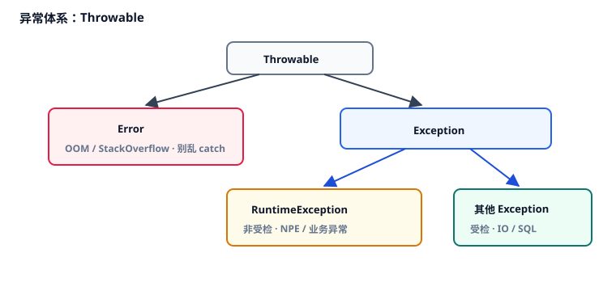

# 6. 异常体系

本章讨论 Java 异常分类、`try/catch/finally` 与 try-with-resources、自定义业务异常、NPE 的常见来源，以及生产中如何保留 cause、如何记日志。文末预告异常与事务回滚的关系。

对应代码：[`ExceptionDemo.java`](./src/main/java/com/jffd/core/exception/ExceptionDemo.java)、[`BizException.java`](./src/main/java/com/jffd/core/exception/BizException.java)

| | |
|--|--|
| 前置 | 第 1 章的 NPE / 拆箱；会写方法与 `try` 的基本直觉。 |
| 学完应能 | 区分受检 / 非受检；写 try-with-resources；设计带 code 的 `BizException` 并保留 cause；列出常见 NPE 场景。 |

下面从异常继承树讲起，一次只加一层概念。

---

## 6.1 异常继承树

所有可抛出的东西都继承自 **`Throwable`**：



### 受检异常与非受检异常

- **受检异常（checked）**：编译器要求你要么 `catch`，要么在方法签名上 `throws`。  
- **非受检异常（unchecked）**：`RuntimeException` 及其子类；编译器不强制处理。  
- **`Error`**：表示严重问题，程序往往已难以继续；不要当成普通业务分支去抓。

| 类型 | 编译器 | 例子 | 常见策略 |
|------|--------|------|----------|
| 受检 Exception | 必须处理 | `IOException`、`SQLException` | 在边界转换，或包装成业务异常 |
| `RuntimeException` | 不强制 | NPE、自定义 `BizException` | 业务失败的主流选择 |
| `Error` | 别随便抓 | OOM | 记录监控；进程可能已不健康 |

现代业务代码里，自定义业务异常通常继承 `RuntimeException`，避免每个方法签名都被 `throws` 淹没。

---

## 6.2 `try` / `catch` / `finally`

```java
try {
    doSomething();
} catch (IllegalArgumentException e) {
    log.warn("bad arg", e);   // 把异常对象传入日志，保留栈
} catch (Exception e) {
    log.error("unknown", e);
    throw e;
} finally {
    // 无论是否异常都会执行；关资源优先用下一节语法
}
```

多个 `catch` 按「先子类、后父类」排列。`finally` 用于清理；若只是关闭流或连接，优先用 try-with-resources。

---

## 6.3 try-with-resources

**try-with-resources** 会在离开 `try` 块时自动调用资源的 `close()`。资源需实现 `AutoCloseable`（或 `Closeable`）。

```java
try (var reader = Files.newBufferedReader(path, StandardCharsets.UTF_8)) {
    return reader.readLine();
}
```

能自动关闭就不要手写冗长的 `finally { close() }`，后者容易漏关，或在关闭时掩盖原始异常。

---

## 6.4 自定义业务异常

业务失败（余额不足、无权限、状态不允许）适合用带错误码的运行时异常表达：

```java
public class BizException extends RuntimeException {
    private final int code;

    public BizException(int code, String message) {
        super(message);
        this.code = code;
    }

    public BizException(int code, String message, Throwable cause) {
        super(message, cause); // 保留因果链
        this.code = code;
    }

    public int getCode() { return code; }
}
```

抛出示例：

```java
if (amount > balance) {
    throw new BizException(4001, "insufficient balance");
}
```

在 Web 层（模块三）通常会被统一转换成类似：

```json
{ "code": 4001, "message": "insufficient balance", "data": null }
```

若底层是 `SQLException`，上层转成 `BizException` 时务必传入 cause：

```java
throw new BizException(5000, "db failed", e);
```

不传 cause，排障时往往只看到「业务失败」，丢失根因堆栈。

---

## 6.5 `NullPointerException`

NPE 表示对 `null` 引用进行了解引用。常见来源：

```java
Integer x = null;
// int y = x;                    // 自动拆箱

// user.getProfile().getCity();  // 中间为 null
// map.get(k).xxx();             // get 得到 null
Boolean flag = null;
// if (flag) { }                 // 拆箱进条件
```

防护习惯：

1. 入参：`Objects.requireNonNull(name, "name")`  
2. 少返回 `null`；单值可用 `Optional`；集合返回空集合  
3. 比较：`"admin".equals(role)`（常量在前）  
4. 包装类型先判空，再进入基本类型运算或 `if`  
5. 后续可用 Bean Validation、IDE 空分析等工具辅助（模块三）

---

## 6.6 生产中怎么使用异常

| 建议 | 避免 |
|------|------|
| 用异常表示意外或业务失败 | 用异常代替普通 `if/else` 控制流 |
| `throw new X("...", e)` 保留 cause | `catch` 后空块，或只 `printStackTrace()` |
| `log.error("ctx...", e)` | 只打 `e.getMessage()`，丢掉堆栈 |
| 在边界统一转换成响应 | 每层 catch 再包一层无信息异常 |
| 该回滚的异常要抛出去 | 吞掉异常导致事务误提交 |

日志示例：

```java
// 好：带上下文，并传入异常对象
log.error("withdraw failed, userId={}, amount={}", userId, amount, e);

// 差
e.printStackTrace();
log.error("failed: " + e.getMessage());
```

SLF4J 等具体日志框架在 Spring 模块落地；这里先建立习惯。

---

## 6.7 异常与事务回滚（预告）

后面讲 Spring + 数据库时会细说。先从异常视角记住三点：

1. `@Transactional` 若被同类方法自调用，可能走不到代理，注解失效。  
2. 异常在方法内被 `catch` 吃掉，代理会认为方法成功，往往不回滚。  
3. 默认通常对 `RuntimeException` / `Error` 回滚；受检异常可能需要配置 `rollbackFor`。

本章学的「抛什么、能不能抛出去」，会直接影响数据会不会回滚。

---

## 6.8 受检异常与 Lambda

多数函数式接口的抽象方法**不**声明 `throws Exception`，因此：

```java
// list.stream().map(path -> Files.readString(path)); // 受检异常，通常编不过
```

常见处理：改回普通循环；包装成未受检异常；或使用团队统一的小工具方法。这是语言历史与函数式风格碰撞的结果，不是个案。

---

## 检验一下

1. 受检与非受检差在哪里？业务异常为什么常选 `RuntimeException`？  
2. try-with-resources 为什么优于手写 `finally { close() }`？  
3. 包装异常时不传 cause 有什么后果？  
4. 举出至少四个典型 NPE 场景。  
5. 异常被吞掉为什么可能导致事务不回滚？

---

## 动手

1. 运行：

```bash
mvn -pl 01-Java-Core-And-OOP exec:java -Dexec.mainClass="com.jffd.core.exception.ExceptionDemo"
```

2. 对照：受检异常捕获、业务码 4001、try-with-resources、常量 `equals`、`requireNonNull`。

---

## 避坑

1. `catch (Exception e) {}`  
2. 用 `printStackTrace` 代替日志  
3. 二次包装时丢失 cause  
4. 把 `Error` 当业务异常抓住后继续跑  
5. 在 Stream 里硬抛受检异常，把代码扭歪  
6. 吞异常导致事务「成功」提交脏数据

## 面试（可选）

- 受检 vs 非受检？  
- `final` / `finally` / `finalize` 别混淆  
- try-with-resources 的大致原理？  
- NPE 常见原因与防范？  
- 事务在哪些情况下可能不回滚？  
- 为什么不要把异常当普通控制流？

## 小结

异常让失败路径显式可见：分清受检与非受检，用 try-with-resources 关资源，业务异常带上 code 与 cause，日志带上栈。模块三会把异常接到 HTTP 响应与事务回滚上。

---

## 模块一收官

对照 Learn 式「Core 学完应能」，跑过第 0 章与各章 Demo 后勾选：

- [ ] 说清基本类型 / 包装类型、装箱拆箱与 NPE  
- [ ] 说清 `==` / `equals`，并正确使用 `final`  
- [ ] 用接口 + 组合表达策略，而不是深继承  
- [ ] 知道 `ArrayList` / `HashMap` 的基本代价、CME、可变 key  
- [ ] 理解泛型擦除与 PECS  
- [ ] 用 Stream 做 filter / map / groupingBy，并知道并行禁区  
- [ ] 设计 `BizException` 并保留 cause  

然后回 [全书路线图](/guide)。准备好了就说「继续模块二」。
